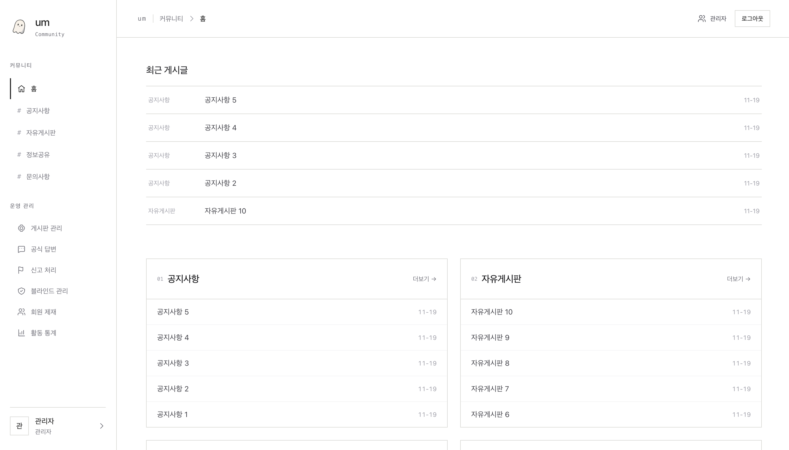
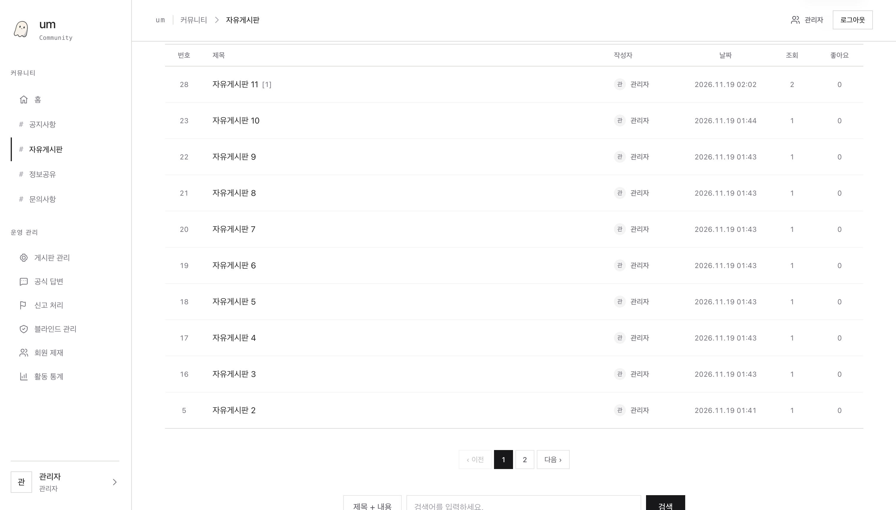
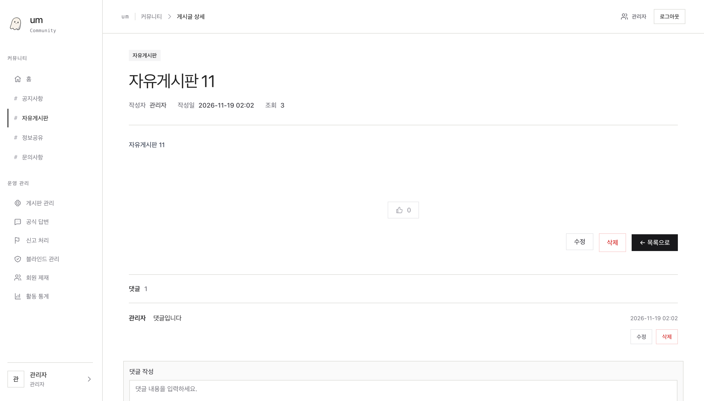
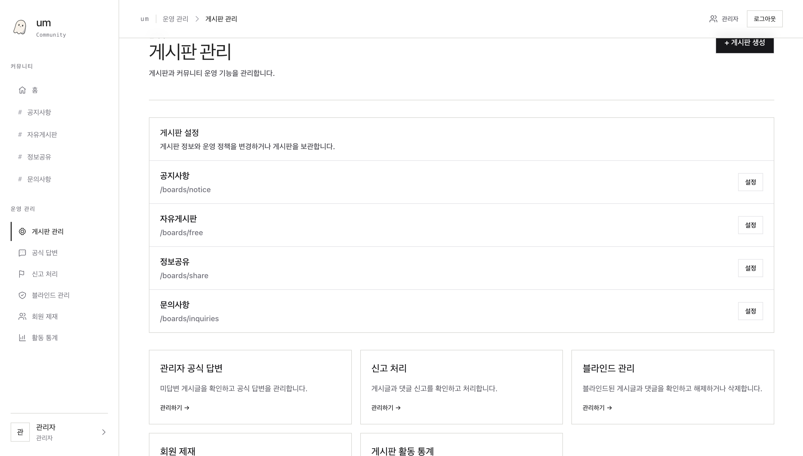
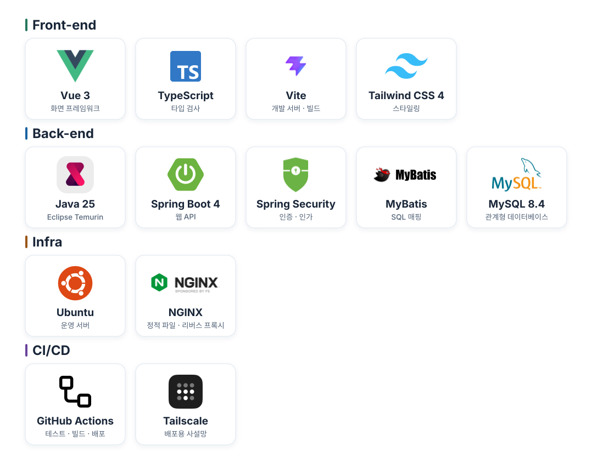
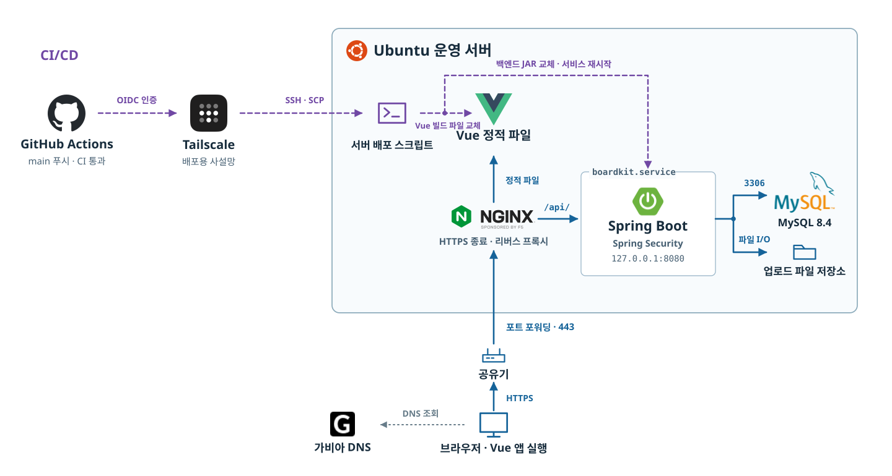

# BoardKit

BoardKit은 운영자가 게시판별로 읽기·쓰기 권한, 댓글, 첨부파일, 비밀글 정책을 설정할 수 있는 커뮤니티 서비스입니다.
게시판 생성부터 글 작성, 문의 답변, 신고 처리까지 하나의 웹 서비스에서 사용할 수 있도록 구현했습니다.

[서비스 바로가기](https://um.kwp6zgnrsh.com) / [소스 코드](https://github.com/kwp6zgnrsh-png/board-kit)

| 항목 | 내용 |
| --- | --- |
| 개발자 | [kwp6zgnrsh-png](https://github.com/kwp6zgnrsh-png) |
| 관심 분야 | 백엔드 기능 설계, MySQL 쿼리 성능 개선, 서비스 배포와 운영 |
| 개발 기간 | 2026.09–2026.11  |
| 개발 인원 및 역할 | 1인 프로젝트 · 요구사항, DB 설계, 백엔드·프론트엔드 구현, 테스트, 배포 전체 담당 |
| 현재 상태 | Ubuntu 서버에 배포 완료 |

## 대상과 문제

공지사항, 자유게시판, 정보공유, 문의사항을 함께 운영하는 커뮤니티 관리자를 대상으로 만들었습니다.
게시판마다 글을 쓸 수 있는 사람과 허용할 기능이 다릅니다.
예를 들어 공지사항은 관리자만 작성하게 하고, 문의사항에는 회원의 비밀글과 관리자의 공식 답변을 허용할 수 있어야 합니다.
이 차이를 게시판 설정으로 관리할 수 있도록 게시판 정보와 운영 정책을 분리했습니다.
관리자가 화면에서 정책을 수정하면, 백엔드 API가 글 작성이나 조회 요청을 받을 때 그 정책과 사용자 권한을 확인합니다.

## 주요 화면

| 홈 | 게시글 목록 |
| :---: | :---: |
|  |  |
| 최근 글과 게시판별 최신 글을 확인합니다. | 목록을 검색하고 페이지를 이동합니다. |
| **게시글 상세** | **게시판 관리** |
|  |  |
| 글 본문과 댓글을 보고 좋아요를 누를 수 있습니다. | 게시판을 만들고 설정을 변경하거나 신고·블라인드 관리로 이동합니다. |

## 주요 기능

- **게시판별 운영 정책**: 관리자는 게시판을 만들거나 보관하고, 각 게시판의 읽기·쓰기 권한과 카테고리, 댓글·첨부파일 허용 여부를 설정합니다. 공지사항을 관리자만 쓸 수 있도록 제한할 수 있습니다.

- **게시글 탐색과 참여**: 사용자는 검색어·카테고리·정렬로 글을 찾습니다. 회원은 게시판 정책에 따라 글과 파일을 올리고 댓글·대댓글을 작성하거나 좋아요를 누를 수 있습니다.

- **문의와 공식 답변**: 회원은 비밀글이 허용된 게시판에서 문의를 비공개로 작성할 수 있습니다. 관리자는 미답변 게시글을 찾아 공식 답변을 달고, 회원은 게시글 상세에서 답변을 확인합니다.

- **신고 처리와 회원 제재**: 회원은 게시글과 댓글을 신고할 수 있습니다. 관리자는 신고를 인정하거나 반려하고, 블라인드 처리·해제와 회원 제재를 관리합니다.

- **게시판 활동 통계**: 관리자는 게시판과 기간을 선택해 게시글·댓글 작성 건수와 날짜별 추이를 차트로 확인합니다.

## 기술 스택

- **Vue · TypeScript**로 게시판과 관리자 화면을 구현하고, Vite로 빌드한 정적 파일을 NGINX에서 제공합니다.
- **Spring Boot · Spring Security**로 게시글·관리 API와 인증·인가를 구현했습니다
- **MyBatis · MySQL**을 사용해 조회 쿼리와 인덱스를 기능별로 조정했습니다.
- **GitHub Actions**에서 백엔드 테스트와 프론트 빌드를 실행합니다.`main`에 반영된 변경이 검증을 통과하면 **Tailscale**을 통해 Ubuntu 서버로 배포합니다. [CI/CD 워크플로](https://github.com/kwp6zgnrsh-png/board-kit/blob/main/.github/workflows/ci.yml)

## 운영 아키텍처

공유기의 포트 포워딩을 거친 HTTPS 요청은 Ubuntu 서버의 NGINX가 받습니다.
NGINX는 Vue 정적 파일을 제공하고 API 요청은 Spring Boot로 전달합니다.
Spring Boot는 같은 서버의 MySQL과 로컬 파일 저장소를 사용합니다.
배포 시에는 GitHub Actions에서 만든 Vue 빌드 파일과 백엔드 JAR을 Tailscale을 통해 해당 서버로 전송합니다.

[DB 설계](https://github.com/kwp6zgnrsh-png/board-kit/blob/main/docs/schema.md) · [초기 스키마](https://github.com/kwp6zgnrsh-png/board-kit/blob/main/docs/schema.sql) · [ERD 원본](https://github.com/kwp6zgnrsh-png/board-kit/blob/main/docs/erd.mmd)

## 내가 해결한 문제

### 1. 게시글 목록의 정렬과 페이지네이션 개선

**문제:** 
게시글이 많아지면서 조회순·오래된순의 첫 페이지 조회와 검색 결과 전체 개수 집계가 각각 지연을 일으켰습니다.

**구현:** 
게시판 ID와 삭제 여부 뒤에 공지 우선 여부 및 정렬 컬럼이 이어지도록 복합 인덱스를 추가했습니다. 
MyBatis 쿼리에서는 페이지 후보의 ID를 먼저 조회하고, 후보에 대해서만 작성자·첨부파일 조회와 댓글·좋아요 집계를 수행하도록 변경했습니다.
일반 목록과 검색에 사용하던 전체 개수 쿼리를 제거하고, 확인된 페이지 범위와 다음 페이지 존재 여부로 페이지 버튼을 그리도록 API 응답과 Vue 화면을 함께 수정했습니다.
[목록 SQL](https://github.com/kwp6zgnrsh-png/board-kit/blob/main/boardKitApi/src/main/resources/mapper/post/PostMapper.xml) · [페이지네이션 변경 커밋](https://github.com/kwp6zgnrsh-png/board-kit/commit/d3cf98b)

**검증:** 
로컬 MySQL 8.1.0에 게시글 300만 건을 넣고, 게시판의 미삭제 게시글에서 검색어·카테고리 없이 첫 페이지 ID 10개를 조회했습니다. 
아래 수치는 정렬 인덱스 추가 전후의 SQL 실행 시간입니다.
[측정 조건과 인덱스 구성](https://github.com/kwp6zgnrsh-png/board-kit/blob/main/docs/schema.md#게시판-목록-정렬-인덱스)

| 정렬 | 인덱스 추가 전 | 인덱스 추가 후 |
| --- | ---: | ---: |
| 오래된순 | 0.814초 | 0.0016초 |
| 조회순 | 10.807초 | 0.0021초 |

### 2. 관리자 블라인드 집계 개선

**문제:** 
관리자 화면이 블라인드된 게시글과 댓글을 표시하기 전에 개수를 집계합니다. 
테스트 데이터가 늘어나자 이 집계가 수 초에서 십여 초까지 걸렸습니다.

**구현:** 
게시글과 댓글에 삭제 여부와 블라인드 시각을 앞에 둔 복합 인덱스를 추가했습니다. 
댓글 인덱스에는 부모 게시글의 삭제 상태를 확인할 때 쓰는 `post_id`도 포함했습니다.
[관리자 조회 SQL](https://github.com/kwp6zgnrsh-png/board-kit/blob/main/boardKitApi/src/main/resources/mapper/report/AdminBlindMapper.xml) · [인덱스 및 측정 기록](https://github.com/kwp6zgnrsh-png/board-kit/blob/main/docs/schema.md#블라인드-관리-조회-인덱스)

**검증:** 
로컬 DB에서 게시글 블라인드 개수 집계는 **8.099초 → 0.010초**, 댓글은 추가 전 반복 측정 **약 12초 → 0.017초**로 줄었습니다.
두 사례의 수치는 로컬 SQL 측정이며, 운영 환경의 API 응답 시간은 따로 측정해야 합니다.

## 배운 점과 다음 개선

- **배운 점:** 게시판 목록에서 사용자에게 필요한 정보는 현재 결과와 다음 페이지 여부였습니다. 
  화면이 필요로 하는 응답부터 다시 정의하면, 전체 개수 집계처럼 비용이 큰 작업을 줄일 수 있음을 배웠습니다.
- **현재 한계**:  목록에 `OFFSET`이 남아 있어 뒤쪽 페이지로 갈수록 건너뛸 행이 늘어납니다.
  제목·본문에 검색어가 드물게 등장하거나 결과가 없는 검색도 더 많은 행을 읽을 수 있습니다.
- **다음 개선:** 같은 300만 건 데이터에서 첫 페이지와 10,001번째 페이지의 실행 시간과 읽은 행 수를 비교하고, 연속 탐색에 커서 기반 조회를 시험할 계획입니다. 같은 필터·정렬에서 글을 중복·누락 없이 탐색할 수 있고 깊은 구간의 읽은 행 수가 줄었는지 `EXPLAIN ANALYZE`로 확인하겠습니다.
