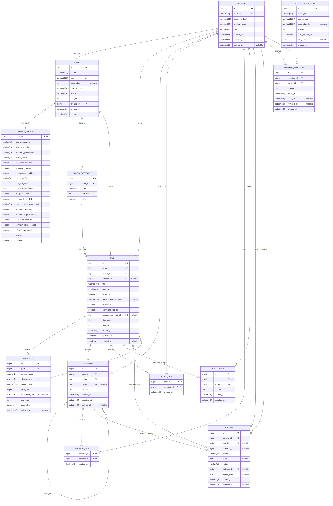

# 커뮤니티 V2 — ERD·컬럼 초안

작성일: 2026-09-19

## 파일

- `schema.sql`: MySQL 8.0.16+ / InnoDB용 DDL. 빈 DB를 명시적으로 선택한 뒤 한 번 실행하는 초기 스키마다.
- `erd.mmd`: Mermaid 원문. 노션의 Mermaid 코드 블록에 내용을 그대로 붙여 넣는다.
- 이 문서는 기존 프로젝트에 적용한 마이그레이션이 아니라 V2 설계 초안이다.

## 확정한 설계

- 게시글은 게시 전 승인 없이 작성 즉시 등록한다. 열람 시에는 게시판 읽기 권한·비밀글·삭제 여부를 별도로 검사한다.
- `secret_mode=OFF`는 새 비밀글 작성과 기존 일반 글의 비밀글 전환을 금지한다. 정책 변경만으로 기존 비밀글의 비밀 여부나 비밀번호 해시를 변경하지 않으며, 기존 비밀글은 비밀 설정을 유지한 채 수정할 수 있다.

- 회원·관리자 계정을 `member`로 통합하고 `role`로 구분한다. 게시판 담당자 테이블은 두지 않는다.
- 회원 탈퇴·게시글 삭제 여부는 각 테이블의 `deleted_at`으로 판단한다. NULL이면 미삭제, 값이 있으면 해당 시점에 탈퇴·삭제 처리된 기록이다.
- 게시판과 게시글을 분리하고 정책으로 게시판을 구성한다. 갤러리 전용 모델은 없다.
- 360×360 썸네일은 원본당 최대 하나이며 `post_file.thumbnail_key`에 위치를 저장한다.
- 별도 신고·제재 이력 테이블을 사용한다. 신고 횟수는 `report`에서 집계한다.
- 관리자 공식 답변은 게시글당 하나다. 문의의 접수·처리 중·완료 상태는 두지 않는다.
- 파일 정리 작업은 DB에 기록하여 재시도한다. 고아 파일 처리 때문에 파일 FK를 두지 않는다.
- 운영 통계는 게시글·댓글 등 기존 기록에서 집계한다.

## 초안으로 선택한 세부 사항

- 문자열 길이·인덱스·기본값과 아래 상태값은 구현 전 검토할 제안이다.
- 모든 ID는 `BIGINT UNSIGNED`. 시간은 `DATETIME(6)`이며 UTC로 저장·해석한다. 애플리케이션 DB 연결에도 같은 시간대 규칙을 적용한다.
- 기본 문자열 비교는 `utf8mb4_0900_ai_ci`이므로 로그인 ID·slug는 대소문자 및 악센트를 구분하지 않는다. 파일 저장 키는 `utf8mb4_bin`으로 구분한다.
- `member.role`: MEMBER / ADMIN
- `board.status`: DRAFT / ACTIVE / ARCHIVED
- `board.display_type`: LIST / CARD — 화면 형태이며 게시판 업무 유형이 아니다.
- 읽기 권한: PUBLIC / MEMBER / ADMIN. 작성·댓글 권한: MEMBER / ADMIN.
- `secret_mode`: OFF / OPTIONAL / REQUIRED. 비밀번호 접근을 지원한다는 전제로 해시 컬럼을 포함했다. 작성자·관리자 전용으로 확정하면 해시 컬럼을 제거할 수 있다.
- `upload_profile`: IMAGE / IMAGE_AND_ZIP. 개별 확장자 선택이 아닌 서버 정의 형식 묶음이다.
- `representative_image_mode`: FIRST_IMAGE / MANUAL
- `report.reason`: SPAM / ABUSE / OTHER. `report.status`: PENDING / ACCEPTED / REJECTED.
- 댓글은 최상위 댓글과 대댓글의 2단계로 가정한다. 최대 글자 수·깊이 설정 컬럼은 아직 추가하지 않았다.
- 신고는 회원당 같은 대상에 한 번만 가능하다. 처리 후에도 재신고는 허용하지 않는 유일성 제약이다.
- 정리 작업은 MOVE / DELETE. 작업 성공 후 행을 제거하는 방식이다. MOVE 이후 보관 기간은 별도 설정이며 아직 정하지 않았다.
- 썸네일의 정확한 정사각형 자르기/여백 처리 및 생성 실패 정책은 미정이다.

## DB 제약과 애플리케이션 책임

### DB에서 보장

- 모든 FK는 RESTRICT이며 자동 연쇄 삭제하지 않는다. 실제 삭제 시 참조를 정리하는 별도 절차가 필요하다.
- `post_reply.post_id` UNIQUE: 게시글당 공식 답변 하나.
- 좋아요 테이블의 대상 ID + 회원 ID 복합 PK: 중복 좋아요 방지.
- 신고 대상은 post_id / comment_id 중 정확히 하나. 각 대상과 신고자의 복합 UNIQUE로 중복 신고 방지.
- 파일 저장 키의 유일성은 각 컬럼 내부에서 보장한다. 원본과 썸네일은 서로 다른 저장 경로 접두어와 재사용하지 않는 키로 생성한다.
- FK 존재 여부는 삭제 표시 여부나 권한까지 보장하지 않는다.

### 서버에서 보장

- 게시판과 정책을 같은 트랜잭션으로 생성한다. DB의 1:0..1 관계에 업무상 필수 정책을 보완한다.
- 작성·조회 권한 조합, 비밀글 정책, 회원 제재 여부를 검사한다.
- 카테고리는 게시글과 같은 게시판에 속해야 한다.
- 대표 파일은 같은 게시글의 삭제되지 않은 이미지여야 한다. 게시글을 대표 파일 NULL로 생성하고 파일 저장 후 대표 파일을 지정한다.
- 부모 댓글은 같은 게시글의 최상위 댓글이어야 한다. 부모 변경·자기 참조·순환 연결을 허용하지 않는다.
- 공식 답변·신고 처리·제재는 ADMIN 권한으로만 실행한다.
- 게시판의 댓글 사용 여부와 개별 게시글의 댓글 잠금을 모두 검사한다. 댓글 기능 비활성화 시 기존 댓글과 좋아요 표시 정책을 따로 적용한다.
- 정책 변경으로 기존 비밀글의 보호나 기존 첨부파일 참조가 사라지지 않게 한다. 썸네일 재생성·삭제는 명시적 작업으로 처리한다.
- 정책 version / 게시글 version은 UPDATE 조건에서 비교하고 성공 시 증가시킨다. 컬럼만으로 낙관적 잠금이 동작하지 않는다.
- `post.updated_at`은 조회수 증가로 바뀌지 않도록 자동 갱신을 사용하지 않는다. 게시글 편집 시 서비스의 UPDATE에서 명시적으로 갱신한다.
- 현재 회원 제재 여부는 `member_sanction`에서 `revoked_at IS NULL`, `starts_at <= 현재 시각`, `ends_at IS NULL OR ends_at > 현재 시각`을 모두 만족하는 기록의 존재 여부로 판단한다. 탈퇴 여부는 `member.deleted_at`으로 별도 검사한다.
- 파일 삭제 표시·대표 파일 해제 또는 교체·정리 작업 등록을 함께 커밋한다. 롤백된 신규 파일 정리 작업은 독립 트랜잭션 등으로 기록한다.
- 고아 파일 탐색은 업로드 유예 시간과 활성 참조·대기 작업 확인이 필요하다. 파일 작업은 재시도해도 안전하게 구현한다.

## 검증 범위

- DDL과 Mermaid의 13개 테이블·117개 컬럼·23개 FK 참조를 정적으로 대조했다.
- 설치된 MySQL 8.1.0으로 별도 임시 인스턴스 검증을 시도했으나, 데이터 디렉토리 초기화 중 서버 프로세스가 signal 11로 종료됐다. DDL 실행 및 DB 제약 동작 검증은 완료하지 못했다.
- 기존 프로젝트 DB에는 접속하거나 변경하지 않았다. 실제 적용 전 별도 빈 DB에서 실행 검증이 필요하다.
- MySQL 문법 참고: [CHECK 제약](https://dev.mysql.com/doc/refman/8.0/en/create-table-check-constraints.html), [FK 제약](https://dev.mysql.com/doc/refman/8.0/en/create-table-foreign-keys.html).

## 컬럼 목록

`PK`: 기본 키, `UK`: 단일 컬럼 유일 키. `NULL 허용` 표기가 없는 컬럼은 NOT NULL.
복합 PK는 표시된 컬럼들의 조합이며, 개별 컬럼이 각각 유일하다는 뜻은 아니다.

### member

- id (PK)
- login_id (UK)
- password_hash
- display_name
- role
- created_at
- updated_at
- deleted_at (NULL 허용)

### board

- id (PK)
- name
- slug (UK)
- description (NULL 허용)
- display_type
- status
- sort_order
- created_by (FK → member.id)
- created_at
- updated_at

### board_policy

- board_id (PK, FK → board.id)
- read_permission
- write_permission
- comment_permission
- secret_mode
- categories_enabled
- category_required
- attachments_enabled
- upload_profile
- max_file_count
- max_file_size_bytes
- image_required
- thumbnail_enabled
- representative_image_mode
- comments_enabled
- comment_replies_enabled
- post_likes_enabled
- comment_likes_enabled
- official_reply_enabled
- version
- updated_at

### board_category

- id (PK)
- board_id (FK → board.id)
- name
- sort_order
- active

### post

- id (PK)
- board_id (FK → board.id)
- author_id (FK → member.id)
- category_id (FK → board_category.id, NULL 허용)
- title
- content
- is_secret
- secret_password_hash (NULL 허용)
- is_pinned
- comments_locked
- representative_file_id (FK → post_file.id, NULL 허용)
- view_count
- version
- created_at
- updated_at
- deleted_at (NULL 허용)

### post_file

- id (PK)
- post_id (FK → post.id)
- original_name
- storage_key (UK)
- content_type
- size_bytes
- thumbnail_key (UK, NULL 허용)
- sort_order
- created_at
- deleted_at (NULL 허용)

### comment

- id (PK)
- post_id (FK → post.id)
- author_id (FK → member.id)
- parent_id (FK → comment.id, NULL 허용)
- content
- created_at
- updated_at
- deleted_at (NULL 허용)

### post_like

- post_id (복합 PK, FK → post.id)
- member_id (복합 PK, FK → member.id)
- created_at

### comment_like

- comment_id (복합 PK, FK → comment.id)
- member_id (복합 PK, FK → member.id)
- created_at

### post_reply

- id (PK)
- post_id (UK, FK → post.id)
- author_id (FK → member.id)
- content
- created_at
- updated_at

### report

- id (PK)
- reporter_id (FK → member.id)
- post_id (FK → post.id, NULL 허용)
- comment_id (FK → comment.id, NULL 허용)
- reason
- detail (NULL 허용)
- status
- reviewed_by (FK → member.id, NULL 허용)
- review_note (NULL 허용)
- created_at
- reviewed_at (NULL 허용)

### member_sanction

- id (PK)
- member_id (FK → member.id)
- admin_id (FK → member.id)
- reason
- starts_at
- ends_at (NULL 허용)
- revoked_at (NULL 허용)
- created_at

### file_cleanup_task

- id (PK)
- task_type
- source_key
- destination_key (NULL 허용)
- attempts
- next_attempt_at
- last_error (NULL 허용)
- created_at

## 추가 복합 제약

- `report`: UNIQUE(reporter_id, post_id), UNIQUE(reporter_id, comment_id)
- `report`: 두 대상 컬럼 중 하나만 값이 있어야 한다.
- 파일 정리 작업: MOVE는 목적지가 필요하며 DELETE는 목적지가 없어야 한다.

## Mermaid

아래는 실제 FK의 카디널리티를 표현한다. 같은 게시글의 대표 파일·같은 게시글의 부모 댓글 조건은 위 서버 검증을 함께 적용해야 한다.

