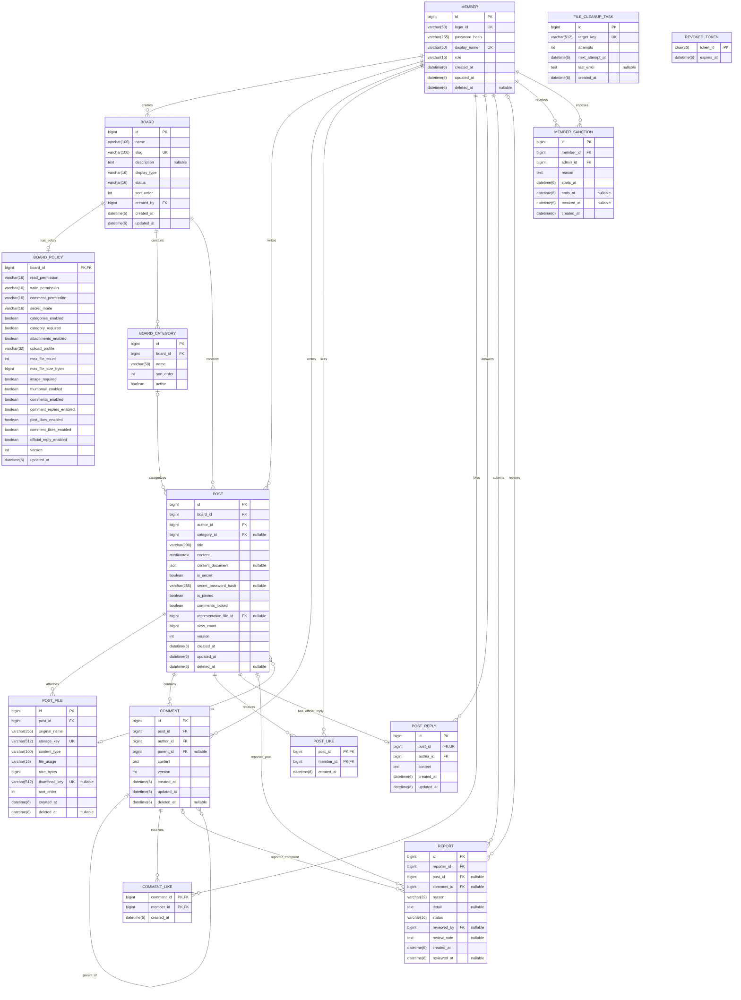

# 커뮤니티 V2 — ERD·컬럼 초안

작성일: 2026-09-19
정책·스키마 갱신일: 2026-10-11

## 파일

- `schema.sql`: MySQL 8.0.16+ / InnoDB용 DDL. 빈 DB를 명시적으로 선택한 뒤 한 번 실행하는 초기 스키마다.
- `erd.mmd`: Mermaid 원문. 노션의 Mermaid 코드 블록에 내용을 그대로 붙여 넣는다.
- 이 문서는 기존 프로젝트에 적용한 마이그레이션이 아니라 V2 설계 초안이다.
- 확정한 업무 정책과 아직 초안인 컬럼 길이·기본값·인덱스를 구분한다. 실제 DB의 스키마와 일치하는지는 별도로 확인해야 한다.

## 확정한 설계

- 게시글은 게시 전 승인 없이 작성 즉시 등록한다. 열람 시에는 게시판 읽기 권한·비밀글·삭제 여부를 별도로 검사한다.
- `secret_mode=OFF`는 새 비밀글 작성과 기존 일반 글의 비밀글 전환을 금지한다. 정책 변경만으로 기존 비밀글의 비밀 여부나 비밀번호 해시를 변경하지 않으며, 기존 비밀글은 비밀 설정을 유지한 채 수정할 수 있다.

- 회원·관리자 계정을 `member`로 통합하고 `role`로 구분한다. 게시판 담당자 테이블은 두지 않는다.
- 로그인 ID와 닉네임은 각각 유일하다. 닉네임은 현재 구현에서 앞뒤 공백을 제거한 뒤 1~10자로 검사한다. DB의 `display_name` 길이 50은 저장 컬럼 초안이며 입력 제한과 구분한다.
- 회원 탈퇴·게시글 삭제 여부는 각 테이블의 `deleted_at`으로 판단한다. NULL이면 미삭제, 값이 있으면 해당 시점에 탈퇴·삭제 처리된 기록이다.
- 게시판과 게시글을 분리하고 정책으로 게시판을 구성한다. 갤러리 전용 모델은 없다.
- 게시판 slug는 생성 후 변경하지 않는다. 게시판 삭제는 `status=ARCHIVED`로 처리하며 게시글·댓글·파일을 연쇄 삭제하지 않는다.
- 비밀글은 게시판 읽기 권한을 통과한 작성자·관리자 또는 비밀번호를 아는 사용자가 열람할 수 있다. 비밀번호 없는 비밀글은 게시판 읽기 권한을 가진 누구나 열람할 수 있다.
- 360×360 썸네일은 원본당 최대 하나이며 `post_file.thumbnail_key`에 위치를 저장한다.
- 별도 신고·제재 이력 테이블을 사용한다. 신고 횟수는 `report`에서 집계한다.
- 관리자 공식 답변은 게시글당 하나다. 문의의 접수·처리 중·완료 상태는 두지 않는다.
- 파일 정리 작업은 DB에 기록하여 재시도한다. 파일 메타데이터가 없는 고아 파일도 처리하도록 `file_cleanup_task`에는 파일 메타데이터 FK를 두지 않는다. `post_file.post_id` FK는 유지한다.
- 운영 통계는 게시글·댓글 등 기존 기록에서 집계한다.
- 파일은 `boardKit/store` 아래 `temp`, `posts`, `thumbnails`에 로컬 저장한다.
- DB의 파일 키는 저장소 루트 기준 상대 경로만 저장한다.
- 게시글과 파일은 하나의 multipart 요청으로 등록하며 별도 임시 업로드 API와 임시 업로드 테이블은 사용하지 않는다.

### 인증 고도화 — 적용 완료

- 확정한 방향: JWT 인증을 유지하고 `HttpOnly` 쿠키로 전송한다. 로그아웃 시 현재 로그인 JWT만 무효화하며 다른 로그인 토큰은 유지한다.
- 쿠키는 JWT의 남은 수명으로 `Max-Age`를 설정하여 브라우저 재실행 후에도 JWT 만료 전까지 유지할 수 있게 한다. 초 단위 전송으로 JWT보다 최대 약 1초 먼저 쿠키가 만료될 수 있다.
- `AuthCookieFactory`는 `boardkit_access_token`, `HttpOnly=true`, `SameSite=Lax`, `Path=/api`, Domain 미지정으로 발급·만료 쿠키를 구성한다. `Secure` 기본값은 true이며 로컬 HTTP에서만 설정으로 false를 사용한다. 만료 쿠키는 같은 범위를 사용하고 `Max-Age=0`으로 설정한다.
- JWT에는 토큰별 UUID인 `jti`와 만료 시각이 필수다. 서버에서 파싱한 `JwtPayload`가 이를 전달하며 이전에 발급한 식별자 없는 JWT는 거절한다.
- `revoked_token`에는 무효화된 토큰의 `jti`와 원래 만료 시각만 저장한다. JWT 원문과 회원 FK는 저장하지 않는다. 같은 토큰의 반복 등록은 기존 기록과 만료 시각을 유지하며, UTC 기준으로 만료된 기록을 정리할 수 있다.
- 현재 구현: 로그인 API는 JWT를 인증 쿠키로 발급하며 응답 본문에는 회원 ID·닉네임·역할만 반환한다. 인증 필터는 쿠키의 JWT를 검증하고 무효화 기록을 조회한다. Bearer 헤더만으로는 인증하지 않는다. 검증된 `JwtPayload`는 인증 객체의 details에 보관한다.
- `POST /api/auth/logout`은 인증 객체의 현재 토큰 식별자·UTC 만료 시각을 무효화 테이블에 저장한 뒤 인증 쿠키를 만료시키고 204를 반환한다. DB 저장 실패 시 쿠키를 만료시키지 않는다. 이미 인증을 통과한 진행 중 요청을 취소하는 방식은 아니다.
- `GET /api/auth/me`는 인증 객체의 회원 ID로 삭제되지 않은 회원을 DB에서 조회해 회원 ID·현재 닉네임·역할만 반환한다. 비밀번호 해시와 JWT 정보는 응답에 포함하지 않는다. 유효한 인증이 없거나 회원이 존재하지 않거나 삭제된 경우 401을 반환한다. 토큰 재발급과 서버 세션 생성은 하지 않는다.
- CSRF는 Spring Security의 SPA 설정과 별도 `XSRF-TOKEN` 쿠키를 사용한다. 이 쿠키는 JavaScript에서 읽을 수 있도록 `HttpOnly=false`, `Path=/`, `SameSite=Lax`이며 Secure는 인증 쿠키와 같은 설정을 따른다. 변경 요청은 `X-XSRF-TOKEN` 헤더로 토큰을 전달한다. `GET /api/auth/csrf`는 비로그인 상태에서도 초기화할 수 있다. 로그인·회원가입의 permitAll 설정도 CSRF 검사를 생략하지 않는다.
- 프론트 공통 요청은 같은 출처의 쿠키를 전송하며 Bearer 헤더를 추가하지 않는다. 변경 요청은 CSRF 쿠키를 읽어 헤더에 넣고, 쿠키가 없으면 초기화 API를 호출한다. 동시에 시작한 초기화 요청은 하나의 Promise를 공유한다. multipart의 Content-Type은 브라우저가 설정하도록 둔다.
- 회원 정보는 Vue의 shallowRef로 메모리에 보관하며 JWT를 sessionStorage에 저장하지 않는다. 이전 `boardkit.auth` 저장 값은 초기화 시 제거한다. 앱 시작 시 현재 회원 조회를 완료한 뒤 라우터를 시작한다. 401이면 비로그인 상태로 진행하고, 통신·서버 오류는 복원 실패로 표시한다.
- 프론트 로그아웃은 서버 API 성공 후 회원 정보를 지우고 홈으로 이동한다. 이미 인증이 유효하지 않은 401도 화면 상태를 정리하며 다른 실패는 오류를 표시한다. 회원 정보 변경 시 메뉴·홈 목록을 다시 조회하고 게시글·댓글 권한 표시를 갱신한다.
- 검증 현황: 현재 회원 조회 테스트를 포함하여 JWT·무효화 Mapper·쿠키·서비스·인증 필터·API의 6개 클래스 총 39개에 대해 실패·오류 0건인 보고서를 확인했다. API 테스트는 실제 보안 필터와 쿠키 팩토리를 사용하지만 서비스·JWT 제공자·무효화 Mapper는 Mock이다. 사용자는 프론트 연결 후 제시한 브라우저·요청 검증 절차의 완료를 보고했다. 에이전트는 적용된 소스를 확인했으며 브라우저 요청이나 테스트를 직접 실행하지 않았다. 자동 테스트의 Mock 범위와 사용자 수동 검증은 구분한다.
- 만료된 무효화 기록을 삭제하는 Mapper는 구현되어 있으나 이를 주기적으로 호출하는 작업은 후속 범위다.
- 리프레시 토큰을 통한 자동 재발급은 아직 구현하지 않았다. 리프레시 토큰과 액세스 토큰의 즉시 무효화는 역할이 다르다.

### 본문과 파일

- 본문은 Tiptap JSON인 `post.content_document`에 저장한다. `post.content`는 서버가 JSON에서 추출한 검색용 일반 텍스트다.
- StarterKit 3.31.4의 글자·문단 서식을 적용했다. 지원 노드는 `doc`, `paragraph`, `text`, `hardBreak`, `image`, `heading`, `bulletList`, `orderedList`, `listItem`, `blockquote`, `codeBlock`, `horizontalRule`이다.
- 글자 서식은 `bold`, `italic`, `underline`, `strike`, `code`, `link`를 허용한다. 인라인 코드는 Tiptap 기본 구조에 맞춰 다른 글자 서식과 함께 적용하지 않는다. 본문 제목은 H2·H3만 허용한다.
- 링크는 호스트가 있는 http·https 웹 주소만 허용하며, 서버는 `href`만 보존한다. mailto·javascript 등 다른 방식과 상대 주소는 거절한다. 프론트 표시 시 링크의 target·rel은 공통 확장 설정을 사용한다.
- 목록에는 `listItem`만 들어가고 각 항목은 문단으로 시작한다. 번호 목록의 시작 번호는 기본 1이며 지정 시 양의 정수여야 한다. 코드 블록은 서식 없는 텍스트를 사용하고 줄바꿈도 텍스트에 포함한다. 코드 언어 속성은 문자열 또는 NULL이며 구문 강조 기능은 추가하지 않았다.
- `PostDocumentValidator`는 본문을 재귀 순회하여 허용된 정보를 새 JSON으로 구성하고 검색용 텍스트·이미지 참조를 문서 순서대로 추출한다. 중복 이미지 참조는 문서 전체에서 검사하며 상태는 요청마다 생성한다. 블록 중첩 깊이 64는 재귀 처리의 기술적 상한이며 게시판별 정책 컬럼은 아니다.
- 상세 화면은 브라우저용 Tiptap `generateHTML()`과 공통 확장·Tailwind 스타일로 표시한다. 사용자 HTML 문자열을 직접 표시하지 않으며, 이미지 속성은 파일 API에서 받은 Blob URL과 표시 상태로 변환한다. 이미지 로딩 중·실패·파일 정보 누락은 본문의 원래 이미지 자리에서 안내한다.
- 텍스트 없이 본문 이미지만 있는 글도 허용한다. 빈 본문에 다운로드 첨부파일만 있는 글은 허용하지 않는다.
- JSON 본문이 없는 기존 글은 `BODY_IMAGE` 파일을 `sort_order`, `id` 순서로 상단에 표시하고 기존 문자열 본문을 이어서 표시한다. 수정 저장 시 JSON 본문으로 전환한다.
- 이미지 버튼은 JPG/JPEG/PNG/GIF 선택 모달을 연다. 처음 적용한 이미지는 본문 상단에 세로 배치하며 이미지 사이에 텍스트를 입력할 수 있다. 커서 위치에 이미지 삽입 버튼은 사용하지 않는다.
- 모달에서는 이미지 미리보기를 드래그해 순서를 바꾸거나 이미지를 삭제한다. 재정렬 시 텍스트·서식·중첩 구조를 유지하고 기존 이미지 자리의 사진만 교체한다. 기존 이미지 자리보다 추가 이미지가 많으면 마지막 이미지 자리 뒤에 같은 컨테이너 안에서 이어서 배치한다. 이미지 제거로 인용문이 비면 빈 문단을 남긴다.
- 모달은 임시 편집 상태를 사용한다. 적용하면 작성·수정 화면의 본문에 반영하고 취소하면 적용 전 상태를 유지한다.
- 모달에서는 브라우저 Object URL로 미리보기만 생성한다. 실제 파일 업로드는 게시글 등록·수정 요청 시 수행한다. 적용한 이미지의 URL은 실행 취소 복구를 위해 폼을 떠날 때 해제한다.
- 파일 버튼은 다운로드 첨부파일을 선택한다. 버튼 표시·추가 허용 여부는 게시판의 `attachments_enabled`와 `upload_profile`을 따른다. 파일 버튼으로 선택한 이미지는 본문에 자동 삽입하지 않는다.
- 허용 형식 묶음은 `IMAGE`(JPG/JPEG/PNG/GIF), `IMAGE_AND_ZIP`(이미지·ZIP), `IMAGE_AND_FILE`(이미지·UTF-8 TXT·ZIP·PDF)이다. 개별 확장자 선택은 사용하지 않는다.
- `post_file.file_usage`는 `BODY_IMAGE` 또는 `ATTACHMENT`다. MIME 타입과 용도는 별개이며 다운로드 목록은 `ATTACHMENT` 파일로 구성한다.
- `image_required` 조건은 본문 이미지로만 충족한다. 다운로드용 이미지 첨부는 조건을 충족하지 않는다.
- 요청의 `contentDocument`에서 새 이미지는 전체 multipart `files` 배열의 0부터 시작하는 `fileIndex`, 기존 이미지는 `fileId`로 참조한다. 둘 중 정확히 하나만 사용한다.
- 저장된 JSON은 이미지의 `fileId`만 참조하며 `fileIndex`, 브라우저 미리보기 URL, 클라이언트 이미지 키는 저장하지 않는다.
- 수정 요청의 `retainedFileIds`는 유지할 기존 본문 이미지와 다운로드 첨부파일의 전체 ID 목록이다. 기존 파일은 재업로드하지 않으며 목록에서 빠진 파일은 soft delete하고 cleanup task를 등록한다.
- 본문 이미지 순서는 중첩 요소를 포함한 JSON 순회를 기준으로 검증하며 서버가 이미지의 `sort_order`에 반영한다. 서버의 `fileIndex` 치환과 프론트의 업로드 배열 구성·기존 이미지 복원도 중첩 구조를 순회한다. 별도 이미지 위치·순서 요청 필드는 사용하지 않는다.
- 같은 이미지 내용을 가진 서로 다른 업로드 파일은 각각 허용한다. 동일한 업로드 파일 참조를 본문에 반복하거나 이미지가 아닌 파일을 본문 이미지로 지정하는 요청은 거절한다.
- 대표 이미지는 같은 게시글의 삭제되지 않은 `BODY_IMAGE` 중 `sort_order`, `id` 순서의 첫 파일이다. 추가·삭제·재정렬 시 다시 선정하며 본문 이미지가 없으면 NULL이다. 다운로드용 이미지는 대표 이미지 대상에서 제외한다.
- 썸네일은 원본 중앙을 잘라 360×360 PNG로 생성한다. GIF의 썸네일은 정적 이미지다. 썸네일 생성 실패는 게시글 등록·수정 실패로 처리한다.
- 게시글 목록의 화면 형태는 `board.display_type`을 따른다. 이미지 유무로 목록형·카드형을 전환하지 않는다. 일반 글의 대표 이미지에 썸네일이 있으면 목록형은 제목 옆 작은 썸네일, 카드형은 카드 이미지 영역에 표시한다.
- 비밀글은 작성자·관리자를 포함해 목록 썸네일을 요청하거나 표시하지 않는다. 상세 본문·파일 조회의 접근 권한은 기존 비밀글 정책을 따른다.
- 썸네일이 없으면 목록형은 썸네일 영역을 생략하고 카드형은 기본 이미지 아이콘을 표시한다. 원본 이미지로 대체하지 않는다. 비밀글의 카드 이미지 영역에도 기본 이미지 아이콘을 표시한다.
- 파일 조회는 게시판 읽기 권한·비밀글 접근·같은 게시글 소속·삭제 여부를 검사하며 조회수를 증가시키지 않는다. 다운로드 응답 여부는 파일 용도로 결정한다.
- 수정 화면의 기존 이미지 로딩 실패 시 저장을 막는다. 상세 화면은 이미지 로딩 실패를 표시하고 나머지 본문은 유지한다.

### 파일 정리

- 업로드 중 생성한 임시 파일은 요청 완료 후 남기지 않는다. 정리에 실패한 파일은 `file_cleanup_task`에 기록한다.
- `temp`, `posts`, `thumbnails`에서 최소 경과 시간(현재 설정 24시간) 이상인 파일을 스캔한다. `trash` 디렉토리와 격리·이동 과정은 사용하지 않는다.
- 삭제 직전 파일 크기·수정 시간 불변과 최소 경과 시간을 재확인하고, `post_file` 참조와 대기 중인 cleanup task가 없을 때 고아 파일을 직접 삭제한다. 삭제 실패 시 재시도 작업을 등록한다.
- 고아 검사에서는 삭제 표시된 `post_file`의 원본·썸네일 키 참조도 포함한다. 삭제 표시된 파일은 DB 기록이 없는 고아 파일과 구분한다.
- 일반 게시글 삭제는 게시글과 `post_file.deleted_at` 기록 및 원본·썸네일의 `file_cleanup_task` 등록을 같은 트랜잭션에서 처리한다. 실제 파일은 요청 중 삭제하지 않고 커밋 후 배치에서 삭제한다. 별도 보관 기간은 추가하지 않는다.
- `PostService.deletePost()`는 게시글 삭제 표시 후 활성 파일을 잠금 조회하여 원본·썸네일 키를 확보하고, 파일 삭제 표시와 cleanup task 등록을 같은 트랜잭션에서 처리한다. 파일이 없으면 작업을 등록하지 않는다. 작업 등록에 실패하면 게시글·파일 삭제 표시와 게시글 버전 변경도 롤백한다.
- 수정 시 명시적으로 제거한 파일도 삭제 표시·대표 이미지 갱신·cleanup task 등록을 같은 트랜잭션에서 처리하고 배치에서 물리 삭제한다.
- cleanup task는 DELETE만 사용한다. 파일이 이미 없으면 삭제 성공으로 처리한다. 성공하면 작업 행을 제거하고 실패하면 `attempts`, `next_attempt_at`, `last_error`를 갱신한다.
- 현재 재시도 간격은 60초부터 지수 증가하며 최대 24시간이다. 파일 삭제 실패는 작업에 기록한 뒤 다음 작업을 처리한다. DB의 작업 기록·완료 처리 자체가 실패하면 해당 실행은 오류로 종료될 수 있다.

## 초안으로 선택한 세부 사항

- 별도로 확정한 정책을 제외한 문자열 저장 길이·인덱스·DB 기본값은 초안이다. 아래 enum 표기는 현재 정책 및 구현에서 사용하는 값이다.
- 모든 ID는 `BIGINT UNSIGNED`. 시간은 `DATETIME(6)`이며 UTC로 저장·해석한다. 애플리케이션 DB 연결에도 같은 시간대 규칙을 적용한다.
- 기본 문자열 비교는 `utf8mb4_0900_ai_ci`이므로 로그인 ID·slug는 대소문자 및 악센트를 구분하지 않는다. 파일 저장 키는 `utf8mb4_bin`으로 구분한다.
- `member.role`: MEMBER / ADMIN
- `board.status`: DRAFT / ACTIVE / ARCHIVED. 현재 생성 API는 ACTIVE로 저장하고 삭제는 ARCHIVED로 처리한다. DRAFT 기본값은 DDL 초안이며 현재 API 흐름에서 사용하지 않는다.
- `board.display_type`: LIST / CARD — 화면 형태이며 게시판 업무 유형이 아니다.
- 읽기 권한: PUBLIC / MEMBER / ADMIN. 작성·댓글 권한: MEMBER / ADMIN.
- `secret_mode`: OFF / OPTIONAL / REQUIRED. 비밀번호 접근을 지원하며 비밀번호는 해시로 저장한다. OFF 전환 시 기존 비밀번호를 초기화하지 않는다.
- `upload_profile`: IMAGE / IMAGE_AND_ZIP / IMAGE_AND_FILE. 각 묶음의 허용 형식은 위 본문과 파일 정책을 따른다.
- `report.reason`: SPAM / ABUSE / OTHER. `report.status`: PENDING / ACCEPTED / REJECTED.
- 댓글은 최상위 댓글과 대댓글의 2단계다. 본문 최대 2,000자는 서버에서 검증하며 최대 글자 수·깊이 설정 컬럼은 두지 않는다.
- 신고는 회원당 같은 대상에 한 번만 가능하다. 처리 후에도 재신고는 허용하지 않는 유일성 제약이다.
- 일반 게시글 삭제 후 파일은 커밋된 cleanup task를 배치에서 처리할 때 물리 삭제한다. 삭제 실패 시 재시도하며 별도 보관 기간은 두지 않는다.

## DB 제약과 애플리케이션 책임

### DB에서 보장

- 모든 FK는 RESTRICT이며 자동 연쇄 삭제하지 않는다. 실제 삭제 시 참조를 정리하는 별도 절차가 필요하다.
- `member.login_id`, `member.display_name` 각각 UNIQUE: 동시 회원가입에서도 로그인 ID·닉네임 중복을 막는다.
- `post_file.file_usage` CHECK: BODY_IMAGE / ATTACHMENT 중 하나다. 파일이 실제 이미지인지는 서버에서 별도로 검증한다.
- `post_reply.post_id` UNIQUE: 게시글당 공식 답변 하나.
- 좋아요 테이블의 대상 ID + 회원 ID 복합 PK: 중복 좋아요 방지.
- 신고 대상은 post_id / comment_id 중 정확히 하나. 각 대상과 신고자의 복합 UNIQUE로 중복 신고 방지.
- 파일 저장 키의 유일성은 각 컬럼 내부에서 보장한다. 원본과 썸네일은 서로 다른 저장 경로 접두어와 재사용하지 않는 키로 생성한다.
- FK 존재 여부는 삭제 표시 여부나 권한까지 보장하지 않는다.

### 서버에서 보장

- 게시판과 정책을 같은 트랜잭션으로 생성한다. DB의 1:0..1 관계에 업무상 필수 정책을 보완한다.
- 작성·조회 권한 조합, 비밀글 정책, 회원 제재 여부를 검사한다.
- 카테고리는 게시글과 같은 게시판에 속해야 한다.
- 대표 파일은 같은 게시글의 삭제되지 않은 BODY_IMAGE여야 한다. 게시글을 대표 파일 NULL로 생성하고 파일 저장 후 본문 순서상 첫 이미지로 지정한다.
- JSON 본문의 구조·지원 요소·텍스트 유무 또는 이미지 유무를 검증한다. 새 이미지의 fileIndex는 전체 multipart 파일 배열을 기준으로 검사한다. 기존 이미지의 fileId는 같은 게시글의 활성 파일이며 retainedFileIds에도 있어야 한다.
- 파일의 개수·파일당 크기·실제 형식·확장자 일치·게시판 허용 묶음을 검증한다. TXT는 UTF-8과 허용된 제어 문자만 받는다. PDF는 현재 헤더 시그니처를 검사하며 문서 전체 구조 검증까지 수행하지 않는다.
- 파일당 최대 크기는 board_policy.max_file_size_bytes로 제한하며 게시글 전체 파일 용량은 서버 설정으로 제한한다. 수정 시 새 파일이 있으면 유지할 기존 파일 개수·용량을 합산한다.
- 새 파일을 추가하지 않는 수정은 기존 파일을 유지할 수 있다. 정책 변경만으로 기존 파일을 제거하지 않으며, 현재 구현은 새 파일 추가 시 현재 형식·개수·용량 정책을 적용한다.
- 부모 댓글은 같은 게시글의 최상위 댓글이어야 한다. 부모 변경·자기 참조·순환 연결을 허용하지 않는다.
- 공식 답변·신고 처리·제재는 ADMIN 권한으로만 실행한다.
- 댓글 작성·수정 시 현재 댓글 권한·댓글 사용 여부·게시글 댓글 잠금을 검사한다. 댓글 기능을 꺼도 기존 댓글은 표시한다. 부모 댓글 삭제 시 삭제 안내를 남기고 기존 대댓글은 표시하되 해당 부모에 새 대댓글을 추가하지 않는다.
- 댓글 페이지는 부모와 대댓글을 합산해 50개씩 구성하며, 페이지를 넘긴 대댓글도 다음 페이지에 바로 표시한다. 댓글 좋아요 기능은 별도 구현 범위다.
- 정책 변경으로 기존 비밀글의 보호나 기존 첨부파일 참조가 사라지지 않게 한다. 썸네일 재생성·삭제는 명시적 작업으로 처리한다.
- 정책 version / 게시글 version / 댓글 version은 UPDATE 조건에서 비교하고 성공 시 증가시킨다. 컬럼만으로 낙관적 잠금이 동작하지 않는다.
- `post.updated_at`은 조회수 증가로 바뀌지 않도록 자동 갱신을 사용하지 않는다. 게시글 편집 시 서비스의 UPDATE에서 명시적으로 갱신한다.
- 현재 회원 제재 여부는 `member_sanction`에서 `revoked_at IS NULL`, `starts_at <= 현재 시각`, `ends_at IS NULL OR ends_at > 현재 시각`을 모두 만족하는 기록의 존재 여부로 판단한다. 탈퇴 여부는 `member.deleted_at`으로 별도 검사한다.
- 수정 중 제거한 파일의 삭제 표시·대표 파일 교체 또는 해제·정리 작업 등록을 함께 커밋한다. DB 롤백 시 새로 만든 파일만 정리하고 정리 실패 작업은 독립 트랜잭션으로 기록한다. DB 트랜잭션이 파일시스템 변경을 자동 롤백하지는 않는다.
- 고아 파일 탐색은 업로드 유예 시간과 삭제 표시된 기록을 포함한 DB 참조·대기 작업 확인이 필요하다. 파일 작업은 재시도해도 안전하게 구현한다.

## 검증 범위

- 2026-10-11 `revoked_token`을 추가한 DDL·별도 Mermaid의 14개 테이블·119개 컬럼 이름이 일치하고, 본문 내 Mermaid와 별도 Mermaid의 내용이 같음을 정적으로 확인했다. 무효화 기록 Mapper 통합 테스트 3개와 쿠키 단위 테스트 4개의 통과 보고서를 확인했으며 에이전트가 직접 테스트를 실행한 것은 아니다.
- 2026-10-08 DDL·별도 Mermaid·본문 내 Mermaid·Markdown 컬럼 목록의 13개 테이블·117개 컬럼과 NULL 허용 여부가 일치함을 정적으로 확인했다. 두 Mermaid의 내용·SQL과 ERD의 컬럼 타입·단일 컬럼 UNIQUE 표시·DDL의 23개 FK 대상 컬럼과 제약 이름 중복 여부도 확인했다.
- 이전 검증 기록에서는 MySQL 8.1.0 임시 인스턴스의 데이터 디렉토리 초기화 중 서버 프로세스가 signal 11로 종료됐다. 갱신한 초기 DDL의 MySQL 실행 및 DB 제약 동작 검증은 이번에도 수행하지 않았다.
- 이번 문서 갱신에서는 기존 프로젝트 DB에 접속하거나 변경하지 않았다. 실제 적용 전 별도 빈 DB에서 초기 DDL 실행 검증이 필요하다. 기존 DB에는 schema.sql을 다시 실행하지 않는다.
- MySQL 문법 참고: [CHECK 제약](https://dev.mysql.com/doc/refman/8.0/en/create-table-check-constraints.html), [FK 제약](https://dev.mysql.com/doc/refman/8.0/en/create-table-foreign-keys.html).

## 컬럼 목록

`PK`: 기본 키, `UK`: 단일 컬럼 유일 키. `NULL 허용` 표기가 없는 컬럼은 NOT NULL.
복합 PK는 표시된 컬럼들의 조합이며, 개별 컬럼이 각각 유일하다는 뜻은 아니다.

### member

- id (PK)
- login_id (UK)
- password_hash
- display_name (UK)
- role
- created_at
- updated_at
- deleted_at (NULL 허용)

### board

- id (PK)
- name
- slug (UK)
- description (NULL 허용)
- display_type
- status
- sort_order
- created_by (FK → member.id)
- created_at
- updated_at

### board_policy

- board_id (PK, FK → board.id)
- read_permission
- write_permission
- comment_permission
- secret_mode
- categories_enabled
- category_required
- attachments_enabled
- upload_profile
- max_file_count
- max_file_size_bytes
- image_required
- thumbnail_enabled
- comments_enabled
- comment_replies_enabled
- post_likes_enabled
- comment_likes_enabled
- official_reply_enabled
- version
- updated_at

### board_category

- id (PK)
- board_id (FK → board.id)
- name
- sort_order
- active

### post

- id (PK)
- board_id (FK → board.id)
- author_id (FK → member.id)
- category_id (FK → board_category.id, NULL 허용)
- title
- content
- content_document (NULL 허용)
- is_secret
- secret_password_hash (NULL 허용)
- is_pinned
- comments_locked
- representative_file_id (FK → post_file.id, NULL 허용)
- view_count
- version
- created_at
- updated_at
- deleted_at (NULL 허용)

### post_file

- id (PK)
- post_id (FK → post.id)
- original_name
- storage_key (UK)
- content_type
- file_usage
- size_bytes
- thumbnail_key (UK, NULL 허용)
- sort_order
- created_at
- deleted_at (NULL 허용)

### comment

- id (PK)
- post_id (FK → post.id)
- author_id (FK → member.id)
- parent_id (FK → comment.id, NULL 허용)
- content
- version
- created_at
- updated_at
- deleted_at (NULL 허용)

### post_like

- post_id (복합 PK, FK → post.id)
- member_id (복합 PK, FK → member.id)
- created_at

### comment_like

- comment_id (복합 PK, FK → comment.id)
- member_id (복합 PK, FK → member.id)
- created_at

### post_reply

- id (PK)
- post_id (UK, FK → post.id)
- author_id (FK → member.id)
- content
- created_at
- updated_at

### report

- id (PK)
- reporter_id (FK → member.id)
- post_id (FK → post.id, NULL 허용)
- comment_id (FK → comment.id, NULL 허용)
- reason
- detail (NULL 허용)
- status
- reviewed_by (FK → member.id, NULL 허용)
- review_note (NULL 허용)
- created_at
- reviewed_at (NULL 허용)

### member_sanction

- id (PK)
- member_id (FK → member.id)
- admin_id (FK → member.id)
- reason
- starts_at
- ends_at (NULL 허용)
- revoked_at (NULL 허용)
- created_at

### file_cleanup_task

- id (PK)
- target_key (UK)
- attempts
- next_attempt_at
- last_error (NULL 허용)
- created_at

### revoked_token

- token_id (PK, JWT의 jti, ASCII·대소문자 구분)
- expires_at (원래 JWT 만료 시각, UTC)
- 회원 FK와 다른 테이블 관계 없음
- 인덱스: expires_at

## 추가 복합 제약

- `report`: UNIQUE(reporter_id, post_id), UNIQUE(reporter_id, comment_id)
- `report`: 두 대상 컬럼 중 하나만 값이 있어야 한다.
- 파일 정리 작업의 target_key는 중복 등록할 수 없다.

## Mermaid

아래는 실제 FK의 카디널리티를 표현한다. 같은 게시글의 대표 파일·같은 게시글의 부모 댓글 조건은 위 서버 검증을 함께 적용해야 한다.

