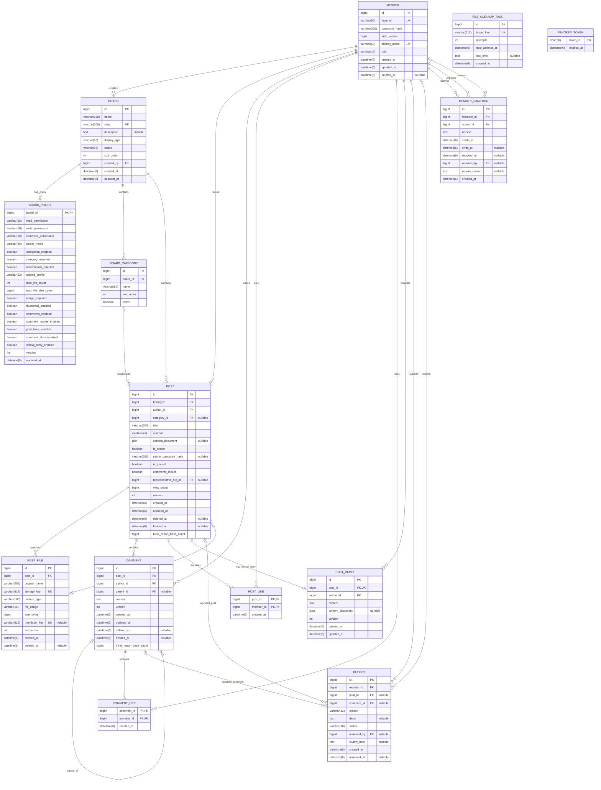

# 커뮤니티 V2 — ERD·컬럼 초안

작성일: 2026-09-19
정책·스키마 갱신일: 2026-10-19

## 파일

- `schema.sql`: MySQL 8.0.16+ / InnoDB용 DDL. 빈 DB를 명시적으로 선택한 뒤 한 번 실행하는 초기 스키마다.
- `erd.mmd`: Mermaid 원문. 노션의 Mermaid 코드 블록에 내용을 그대로 붙여 넣는다.
- 이 문서는 기존 프로젝트에 적용한 마이그레이션이 아니라 V2 설계 초안이다.
- 확정한 업무 정책과 아직 초안인 컬럼 길이·기본값·인덱스를 구분한다. 실제 DB의 스키마와 일치하는지는 별도로 확인해야 한다.

## 확정한 설계

- 게시글은 게시 전 승인 없이 작성 즉시 등록한다. 열람 시에는 게시판 읽기 권한·비밀글·삭제 여부를 별도로 검사한다.
- `secret_mode=OFF`는 새 비밀글 작성과 기존 일반 글의 비밀글 전환을 금지한다. 정책 변경만으로 기존 비밀글의 비밀 여부나 비밀번호 해시를 변경하지 않으며, 기존 비밀글은 비밀 설정을 유지한 채 수정할 수 있다.

- 회원·관리자 계정을 `member`로 통합하고 `role`로 구분한다. 게시판 담당자 테이블은 두지 않는다.
- 로그인 ID와 닉네임은 각각 유일하다. 닉네임은 현재 구현에서 앞뒤 공백을 제거한 뒤 1~10자로 검사한다. DB의 `display_name` 길이 50은 저장 컬럼 초안이며 입력 제한과 구분한다.
- 회원 탈퇴·게시글 삭제 여부는 각 테이블의 `deleted_at`으로 판단한다. NULL이면 미삭제, 값이 있으면 해당 시점에 탈퇴·삭제 처리된 기록이다.
- 게시판과 게시글을 분리하고 정책으로 게시판을 구성한다. 갤러리 전용 모델은 없다.
- 게시판 slug는 생성 후 변경하지 않는다. 게시판 삭제는 `status=ARCHIVED`로 처리하며 게시글·댓글·파일을 연쇄 삭제하지 않는다.
- 비밀글은 게시판 읽기 권한을 통과한 작성자·관리자 또는 비밀번호를 아는 사용자가 열람할 수 있다. 비밀번호 없는 비밀글은 게시판 읽기 권한을 가진 누구나 열람할 수 있다.
- 360×360 썸네일은 원본당 최대 하나이며 `post_file.thumbnail_key`에 위치를 저장한다.
- 별도 신고·제재 이력 테이블을 사용한다. 신고 횟수는 `report`에서 집계한다.
- 관리자 공식 답변은 게시글당 하나다. 문의의 접수·처리 중·완료 상태는 두지 않는다.
- 파일 정리 작업은 DB에 기록하여 재시도한다. 파일 메타데이터가 없는 고아 파일도 처리하도록 `file_cleanup_task`에는 파일 메타데이터 FK를 두지 않는다. `post_file.post_id` FK는 유지한다.
- 운영 통계는 게시글·댓글 등 기존 기록에서 집계한다.
- 파일은 `boardKit/store` 아래 `temp`, `posts`, `thumbnails`에 로컬 저장한다.
- DB의 파일 키는 저장소 루트 기준 상대 경로만 저장한다.
- 게시글과 파일은 하나의 multipart 요청으로 등록하며 별도 임시 업로드 API와 임시 업로드 테이블은 사용하지 않는다.

### 게시판 활동 통계 — 응답 DTO 적용 확인, 조회 구현 진행

- 전체 현황, 날짜별 게시글·댓글 작성 추이, 같은 기간의 게시판별 작성 수 비교를 제공한다. 추이는 전체 게시판 합산 또는 선택한 게시판으로 조회한다.
- 기간은 7일·30일·90일, 기본 30일로 진행한다. 대댓글은 댓글 수에 포함한다.
- 현재 보유 수는 삭제되지 않은 게시글·댓글을 기준으로 한다. 부모 게시글이 삭제되었더라도 댓글 자체가 삭제되지 않았다면 현재 댓글 수에 포함한다. 날짜별 작성 추이는 이후 삭제되더라도 해당 날짜의 작성 활동으로 포함한다. 현재 보유 수와 기간 내 작성 수는 서로 다른 지표다.
- 별도 통계 테이블·캐시·집계 배치를 먼저 추가하지 않고 기존 게시글·댓글 기록에서 집계한다. 공식 답변은 댓글 수에 합산하지 않는 안이며 별도 변경 요청이 없으면 게시글·댓글 지표만 구현한다.
- 하루는 한국 시각 `Asia/Seoul` 기준으로 구분한다. DB의 UTC 저장 규칙과 구분하고, 조회 날짜 범위는 서버에서 UTC 시각으로 변환하여 적용한다.
- 통계 대상은 `ACTIVE`·`ARCHIVED` 게시판이며 `DRAFT`는 제외한다. 게시판이 보관되어도 기존 작성 활동을 집계에서 제외하지 않는다.
- 구현 순서는 응답 DTO → Mapper/XML → Service → 관리자 API 및 백엔드 테스트 → 프론트 API·통계 화면·차트 → 브라우저 확인이다. 기능 코드는 사용자가 직접 작성하며, 문서 반영은 구현 완료를 의미하지 않는다.
- 응답 DTO `BoardStatisticsSummaryResponse`, `BoardDailyActivityResponse`, `BoardActivityResponse`와 상단 현황용 `BoardStatisticsMapper.selectSummary`·XML·통합 테스트의 소스 적용을 확인했다. 전체 합산 테스트의 최초 실패는 MyBatis 기준값 조회 후 JdbcTemplate으로 fixture를 INSERT하여 1차 캐시가 남은 문제였다. 준비 마지막의 `SqlSessionTemplate.clearCache()` 적용과 최신 JUnit XML의 2개 통과를 확인했다. 에이전트가 직접 재실행한 결과는 아니다.
- 현황 조회는 게시글·댓글을 독립적으로 COUNT하여 조인 증폭을 피한다. 현재 댓글 수의 게시글 조인은 소속 게시판을 확인하기 위한 것이며 부모 게시글의 삭제 여부로 댓글을 제외하지 않는다. 오늘 작성 수는 삭제 조건 없이 UTC로 변환한 날짜 범위 `[시작, 다음 날 시작)`를 적용한다.
- 날짜별 추이 `selectDailyActivities(boardId, startUtc, endUtc)`와 전체 대상 게시판별 기간 비교 `selectBoardActivities(startUtc, endUtc)`의 소스 적용을 확인했다. 추이는 선택한 게시판 또는 전체를 합산하고, 비교 조회는 활성·보관 게시판을 작성 0건인 경우도 포함한다. 한국 날짜 묶음은 UTC 저장 시각을 `+09:00`으로 변환하여 구하며 숫자 오프셋을 사용하여 MySQL 시간대 테이블 설치에 의존하지 않는다. WHERE의 기간 조건은 원본 created_at에 적용한다. 2026-10-19T12:40:58.155Z JUnit XML에서 기존 현황 조회를 포함한 Mapper 통합 테스트 5개 통과를 확인했다. 이번 확인에서 에이전트가 직접 실행한 결과는 아니다.
- `BoardStatisticsService.getStatistics`·통합 응답 DTO·TimeConfig의 소스 적용을 확인했다. Service는 활성 관리자 확인, 허용 기간 및 선택 게시판 검증, 오늘을 포함한 7·30·90일 범위 계산과 날짜별 0건 보정, 통합 응답 DTO 조립을 담당한다. 선택 게시판은 기간 비교 결과의 대상 게시판 목록으로 검증하여 별도 존재 조회를 추가하지 않는다. 여러 조회의 일관성은 읽기 전용 REPEATABLE_READ 트랜잭션으로 유지한다. Java 표준 Clock Bean을 주입하고 테스트에서는 한국 자정에 해당하는 고정 시각을 사용한다. 기존 보고서에서 Service 9개·Mapper 5개 통과를 확인했으며 에이전트가 이번에 직접 실행한 결과는 아니다.
- `GET /api/admin/board-statistics`의 소스 적용을 확인했다. `days` 기본값은 30이며 7·30·90만 Service에서 허용한다. `boardId` 생략 시 전체, 지정 시 양수여야 하며 통계 대상 게시판이어야 한다. ADMIN 메서드 권한 검사와 인증 객체의 회원 ID를 사용하고, 성공 응답에 `Cache-Control: no-store`를 적용한다. 기존 보안 설정을 재사용하며 GET에 CSRF 토큰을 요구하지 않는다. 기존 JUnit 보고서에서 API 9개·Service 9개·Mapper 5개, 총 23개 통과를 확인했으며 이번 확인에서 에이전트가 직접 실행한 결과는 아니다.
- 프론트 타입 `features/board/types/boardStatistics.ts`와 조회 함수의 소스 적용을 확인했다. API 파일명의 오타 수정 후 `api/adminBoardStatisticsApi.ts`가 존재하고 화면의 import와 일치하는 것을 확인했다. 기간은 `7 | 30 | 90`, 응답의 전체 게시판 ID는 null, 조회 옵션에서는 boardId 생략으로 전체를 표현한다. 날짜는 서버의 한국 날짜 문자열을 유지하고 기존 apiRequest의 쿠키·오류 처리를 재사용한다. 프론트 빌드 결과는 아직 확인하지 않았다.
- 데이터 표시용 `BoardStatisticsSummary.vue`, 조회·URL 필터·로딩·오류 처리를 담당하는 `AdminBoardStatisticsView.vue`, 관리자 라우트 및 대시보드 통계 링크의 소스 적용을 확인했다. 기존 BaseSelect·BaseButton을 재사용하고 Tailwind로 작성했다. 게시판·기간 변경 시 이전 결과를 숨기고 요청 순서·현재 관리자 확인으로 오래된 응답 반영을 막는다. 빌드·브라우저 검증은 아직 확인 전이다.
- 차트·비교 표 단계는 Chart.js 4와 vue-chartjs 5를 사용하는 `BoardActivityChart.vue`, 전체 게시판의 기간별 작성 수를 표시하는 `BoardActivityTable.vue` 코드 제공이다. 그래프는 서버의 한국 날짜 문자열·0건 보정 데이터를 그대로 사용하며 두 선·정수 세로축·애니메이션 비활성화·날짜별 수치 표를 제공한다. 비교 표는 작성 0건 게시판과 합계를 포함하며 선택 게시판 행을 표시한다. 현 package.json에는 차트 의존성이 없으므로 설치 명령을 안내하며 에이전트가 설치하거나 기능 코드를 수정하지 않는다. 사용자 적용·빌드·브라우저 검증은 아직 확인 전이다.

### 인증 고도화 — 적용 완료

- 확정한 방향: JWT 인증을 유지하고 `HttpOnly` 쿠키로 전송한다. 로그아웃 시 현재 로그인 JWT만 무효화하며 다른 로그인 토큰은 유지한다.
- 쿠키는 JWT의 남은 수명으로 `Max-Age`를 설정하여 브라우저 재실행 후에도 JWT 만료 전까지 유지할 수 있게 한다. 초 단위 전송으로 JWT보다 최대 약 1초 먼저 쿠키가 만료될 수 있다.
- `AuthCookieFactory`는 `boardkit_access_token`, `HttpOnly=true`, `SameSite=Lax`, `Path=/api`, Domain 미지정으로 발급·만료 쿠키를 구성한다. `Secure` 기본값은 true이며 로컬 HTTP에서만 설정으로 false를 사용한다. 만료 쿠키는 같은 범위를 사용하고 `Max-Age=0`으로 설정한다.
- JWT에는 토큰별 UUID인 `jti`, 만료 시각, 회원 인증 버전인 `authVersion`이 필수다. 서버에서 파싱한 `JwtPayload`가 이를 전달하며 필수 값이 없거나 인증 버전이 음수인 JWT는 거절한다. 인증 버전이 없는 기존 JWT는 다시 로그인해야 한다.
- `revoked_token`에는 무효화된 토큰의 `jti`와 원래 만료 시각만 저장한다. JWT 원문과 회원 FK는 저장하지 않는다. 같은 토큰의 반복 등록은 기존 기록과 만료 시각을 유지하며, UTC 기준으로 만료된 기록을 정리할 수 있다.
- 현재 구현: 로그인 API는 DB의 `member.auth_version`을 JWT에 기록하여 인증 쿠키로 발급하며 응답 본문에는 회원 ID·닉네임·역할만 반환한다. 인증 필터는 쿠키의 JWT를 검증하고 무효화 기록과 활성 회원의 인증 버전 일치 여부를 DB에서 확인한다. 조회 실패 시 인증을 통과시키지 않는다. Bearer 헤더만으로는 인증하지 않는다. 검증된 `JwtPayload`는 인증 객체의 details에 보관한다.
- `POST /api/auth/logout`은 인증 객체의 현재 토큰 식별자·UTC 만료 시각을 무효화 테이블에 저장한 뒤 인증 쿠키를 만료시키고 204를 반환한다. DB 저장 실패 시 쿠키를 만료시키지 않는다. 이미 인증을 통과한 진행 중 요청을 취소하는 방식은 아니다.
- `GET /api/auth/me`는 인증 객체의 회원 ID로 삭제되지 않은 회원을 DB에서 조회해 회원 ID·현재 닉네임·역할만 반환한다. 비밀번호 해시와 JWT 정보는 응답에 포함하지 않는다. 유효한 인증이 없거나 회원이 존재하지 않거나 삭제된 경우 401을 반환한다. 토큰 재발급과 서버 세션 생성은 하지 않는다.
- CSRF는 Spring Security의 SPA 설정과 별도 `XSRF-TOKEN` 쿠키를 사용한다. 이 쿠키는 JavaScript에서 읽을 수 있도록 `HttpOnly=false`, `Path=/`, `SameSite=Lax`이며 Secure는 인증 쿠키와 같은 설정을 따른다. 변경 요청은 `X-XSRF-TOKEN` 헤더로 토큰을 전달한다. `GET /api/auth/csrf`는 비로그인 상태에서도 초기화할 수 있다. 로그인·회원가입의 permitAll 설정도 CSRF 검사를 생략하지 않는다.
- 프론트 공통 요청은 같은 출처의 쿠키를 전송하며 Bearer 헤더를 추가하지 않는다. 변경 요청은 CSRF 쿠키를 읽어 헤더에 넣고, 쿠키가 없으면 초기화 API를 호출한다. 동시에 시작한 초기화 요청은 하나의 Promise를 공유한다. multipart의 Content-Type은 브라우저가 설정하도록 둔다.
- 회원 정보는 Vue의 shallowRef로 메모리에 보관하며 JWT를 sessionStorage에 저장하지 않는다. 이전 `boardkit.auth` 저장 값은 초기화 시 제거한다. 앱 시작 시 현재 회원 조회를 완료한 뒤 라우터를 시작한다. 401이면 비로그인 상태로 진행하고, 통신·서버 오류는 복원 실패로 표시한다.
- 프론트 로그아웃은 서버 API 성공 후 회원 정보를 지우고 홈으로 이동한다. 이미 인증이 유효하지 않은 401도 화면 상태를 정리하며 다른 실패는 오류를 표시한다. 회원 정보 변경 시 메뉴·홈 목록을 다시 조회하고 게시글·댓글 권한 표시를 갱신한다.
- 검증 현황: 현재 회원 조회 테스트를 포함하여 JWT·무효화 Mapper·쿠키·서비스·인증 필터·API의 6개 클래스 총 39개에 대해 실패·오류 0건인 보고서를 확인했다. API 테스트는 실제 보안 필터와 쿠키 팩토리를 사용하지만 서비스·JWT 제공자·무효화 Mapper는 Mock이다. 사용자는 프론트 연결 후 제시한 브라우저·요청 검증 절차의 완료를 보고했다. 에이전트는 적용된 소스를 확인했으며 브라우저 요청이나 테스트를 직접 실행하지 않았다. 자동 테스트의 Mock 범위와 사용자 수동 검증은 구분한다.
- 만료된 무효화 기록을 삭제하는 Mapper는 구현되어 있으나 이를 주기적으로 호출하는 작업은 후속 범위다.
- 리프레시 토큰을 통한 자동 재발급은 아직 구현하지 않았다. 리프레시 토큰과 액세스 토큰의 즉시 무효화는 역할이 다르다.

### 회원 프로필

- `GET /api/members/me`는 인증된 회원의 ID·로그인 ID·닉네임·역할·가입일을 반환하고 `Cache-Control: no-store`를 적용한다. 비밀번호 해시와 인증 버전은 응답에 포함하지 않는다.
- `PATCH /api/members/me/display-name`은 인증된 회원의 닉네임을 변경한다. 앞뒤 공백 제거 후 1~10자와 유일성을 검사하고, 현재 닉네임과 같으면 UPDATE 없이 성공한다. 동시 변경의 UNIQUE 충돌도 409로 처리한다. 닉네임 변경은 인증 버전을 증가시키지 않는다.
- `PATCH /api/members/me/password`는 현재 비밀번호를 확인하고 새 비밀번호·확인값의 일치 및 기존과 다른 비밀번호인지를 검사한다. 새 비밀번호는 공백 없는 ASCII 영문·숫자·특수문자로 12~64자다. 현재 비밀번호에는 새 비밀번호의 최소 길이 규칙을 적용하지 않는다.
- 비밀번호 해시 변경·`auth_version` 증가·수정 시각 변경은 하나의 UPDATE와 서비스 트랜잭션으로 처리한다. WHERE에서 조회 당시 인증 버전을 비교하여 이전 버전의 변경 요청이 덮어쓰지 못하게 한다. 수정 결과 0건은 409로 반환한다.
- 비밀번호 변경 커밋 후 모든 기존 JWT는 이후 인증 검사에서 거절된다. 성공 응답은 현재 브라우저의 인증 쿠키를 만료시키고 204를 반환한다. 검증·저장 실패 시 성공용 쿠키 만료 응답을 보내지 않는다. 현재 비밀번호 오류는 400이며, 유효하지 않은 회원은 401이다.
- BCrypt의 72바이트 처리 한도는 `common.security.PasswordLimits`에서 공유한다. 회원의 새 비밀번호 입력 정책과 비밀글 비밀번호 입력 정책 자체를 통합한 것은 아니다.
- 마이페이지의 프로필·내 글·내 댓글 조회는 `member` 패키지의 API·Service·Mapper·응답 DTO에 모은다. 게시글·댓글 자체의 작성·수정·삭제 및 게시글별 댓글 조회는 기존 도메인에 유지한다.

### 내가 쓴 글

- `GET /api/members/me/posts`는 인증된 회원의 삭제되지 않은 게시글을 페이지 단위로 반환한다. 회원 ID는 요청 값이 아닌 인증 객체에서 가져오고 `Cache-Control: no-store`를 적용한다.
- 기본값은 page=1, size=10이며 page는 1 이상, size는 1~100이다. 작성 시각 내림차순·동일 시각의 ID 내림차순으로 정렬한다. 내역이 없거나 마지막 페이지를 넘으면 빈 목록을 반환한다.
- 보관된 게시판과 현재 읽기 권한이 없는 게시판의 내 글도 포함한다. 이 목록의 조회 권한과 원문 상세의 조회 권한은 구분하며, 상세 접근은 기존 게시판·비밀글 검사를 유지한다.
- 목록에는 게시글 ID·게시판 slug/이름/상태·제목·비밀글 여부·조회수·작성 시각을 반환한다. 삭제된 글은 목록과 개수에서 모두 제외한다.
- `MemberMapper`에서 작성자·삭제 여부로 개수와 목록을 조회하며, 목록 쿼리는 게시판 정보를 JOIN한다. 기존 `ix_post_author_list`가 작성자·삭제 여부·정렬 컬럼을 포함한다.

### 내가 쓴 댓글

- `GET /api/members/me/comments`는 인증된 회원의 삭제되지 않은 댓글·대댓글을 반환한다. 기본 page=1, size=10이며 page는 1 이상, size는 1~100이다. 회원 ID는 인증 객체에서 가져오고 `Cache-Control: no-store`를 적용한다.
- 댓글 자체가 삭제되면 제외하지만, 원본 게시글이나 부모 댓글이 삭제되어도 활성 상태인 본인 댓글·대댓글은 계속 표시한다. 보관·접근 제한 게시판의 본인 댓글도 포함한다. 원문 상세 접근은 기존 권한 검사에 따른다.
- 목록은 댓글 작성 시각·ID 내림차순이다. 마이페이지 작성 내역의 정렬이며 게시글 상세의 댓글 트리 정렬과는 별개다.
- 댓글 ID·게시글 ID·부모 댓글 ID·게시판 slug/이름/상태·원글 삭제 여부(`postDeleted`)·본인 댓글 본문·작성 시각을 반환한다. 다른 사람이 작성한 원글 제목·본문은 이 응답에 포함하지 않는다.
- 개수는 댓글 작성자·삭제 여부로 집계하며 목록은 게시글·게시판을 JOIN한다. soft delete된 게시글도 행이 유지되므로 JOIN과 원글 삭제 여부 확인이 가능하다. 기존 `ix_comment_author`가 작성자·삭제 여부·정렬 컬럼을 포함한다.

### 마이페이지 프론트

- 인증이 필요한 `/me` 경로에 기본 정보, 닉네임 변경, 비밀번호 변경, 내 게시글, 내 댓글을 개별 컴포넌트로 연결했다. 상단 메뉴에서 마이페이지로 이동한다. 프로필 이미지·소개 편집은 이번 범위에 포함하지 않는다.
- 닉네임 변경 성공 후 프로필을 다시 조회하여 기본 정보와 메모리의 인증 정보를 갱신한다. 상단 닉네임도 함께 갱신하며 인증 쿠키는 유지한다. 저장 성공 안내와 이후 프로필 재조회 오류는 구분한다.
- 비밀번호 변경 성공 후 입력값과 프론트 인증 상태를 지우고 로그인 화면으로 이동하여 완료 안내를 표시한다. 별도 로그아웃 API는 호출하지 않는다. 서버의 인증 버전 변경으로 다른 기기의 기존 JWT도 다음 인증 요청에서 거절된다.
- 내 게시글·댓글은 각각 10개씩 조회한다. 페이지 번호는 `/me?postPage=2&commentPage=3`처럼 별도 쿼리로 관리하며 서로의 조건을 유지한다. 새로고침·브라우저 뒤로가기에서 페이지를 복원하고, 삭제 등으로 요청 페이지가 마지막 페이지를 넘으면 현재 마지막 페이지로 이동한다.
- 각 목록은 로딩·오류·빈 목록과 별도 새로고침 버튼을 제공한다. 요청 순번 및 회원 ID를 확인하고 컴포넌트 해제 시 요청 순번을 변경하여 이전 응답이 화면을 덮어쓰지 않도록 한다. 마이페이지 상단 새로고침은 프로필만 갱신한다.
- 댓글은 본인 내용의 최대 3줄 미리보기, 대댓글 구분, 게시판과 작성일을 표시한다. 원문 삭제 시 댓글은 유지하고 원문 이동 링크를 숨긴다. 활성 원문의 링크는 게시글 상세로 이동하며 특정 댓글 위치·댓글 페이지까지 자동 이동하지 않는다. 보관 게시판은 표시로 구분하며 상세 접근 권한을 우회하지 않는다.

### 회원 제재 관리 — 시간 기준 결함 수정 및 회귀 테스트 완료

- 2026-10-19 에이전트의 실제 브라우저 검증에서 진행 중인 기간제 제재의 중복 등록 허용과 등록 일시의 9시간 차이를 확인했다. 이후 현재 제재 판정을 `UTC_TIMESTAMP(6)`로 통일하고 INSERT에서 `created_at`을 같은 UTC 함수로 명시하도록 수정했다. 비UTC DB 세션에서 수정 전 실패를 재현한 뒤 관련 테스트 93개 통과를 확인했다. 수정 후 브라우저 재검증은 서버 재시작 후 진행한다. 기존 데이터의 시각은 일괄 보정하지 않았다. 상세 결과는 `integration-test-guide.md`를 참고한다.

- 활성 ADMIN이 일반 회원의 제재를 등록·해제한다. ADMIN 계정은 제재 대상에서 제외한다.
- 제재는 등록 시 서버가 정한 현재 시각부터 즉시 시작한다. 종료 일시를 지정하며, `ends_at IS NULL`이면 영구 제재다. 예약 제재 입력은 제공하지 않는다.
- 현재 유효한 제재가 있는 회원에게는 중복 등록을 거절한다. 변경이 필요하면 기존 제재를 해제한 뒤 새 기록을 등록하여 이력을 유지한다.
- 제재 사유와 해제 사유는 각각 필수이며 공백뿐인 값은 허용하지 않는다. 최대 길이는 기존 입력 검증과 동일하게 Java 문자열 길이 기준 2,000자다. 최초 처리자는 `admin_id`, 해제 시각·처리자·사유는 `revoked_at`·`revoked_by`·`revoke_reason`에 저장한다.
- 등록 요청 DTO는 `memberId`·`reason`·`endsAt`, 해제 요청 DTO는 `revokeReason`으로 구성한다. 대상 회원 ID는 필수 양수이며 시작 시각·등록/해제 관리자 ID·해제 시각은 클라이언트 입력으로 받지 않는다.
- 종료 일시는 요청에서 시간대 오프셋이 포함된 `OffsetDateTime`으로 받고 저장 시 UTC `LocalDateTime`으로 변환한다. null은 영구 제재이고, 값이 있으면 현재보다 미래인지 검사한다. 실제 등록 시점의 기간 검증은 Service에서도 수행한다. Service의 저장 시각은 `DATETIME(6)`에 맞춰 마이크로초 단위로 맞춘 뒤 비교한다.
- 기간 만료는 현재 시각과 `ends_at`을 비교해 판단한다. 자연 만료 시 해제자나 해제 사유를 자동 생성하지 않는다. 시간은 기존 규칙에 따라 UTC로 저장·해석한다.
- 만료되었거나 이미 해제된 제재는 이력만 조회하며 해제를 거절한다. 탈퇴한 회원도 이력만 조회하며 제재 신규 등록과 기존 제재 해제를 거절한다.
- 현재 제재 판정은 기존 `existsActiveSanctionByMemberId`를 활용하되 UTC로 저장된 시작·종료 시각을 `UTC_TIMESTAMP(6)`와 비교한다. 로그인·조회 및 본인 삭제를 허용하고, 기존 글·댓글 작성 및 수정·새 좋아요·신고 제한을 유지한다. 좋아요 취소는 기존 기능·접근 권한 정책을 적용한다.
- 진행 중 제재의 중복 방지는 구현 시 대상 회원 행을 잠근 뒤 현재 제재 확인과 INSERT를 같은 트랜잭션으로 처리한다. `member_id` 단독 UNIQUE는 과거 이력의 재등록까지 막으므로 추가하지 않는다.
- Mapper 설계는 기존 `MemberMapper`에 활성 회원의 `FOR UPDATE` 조회를 추가하고, 별도 `MemberSanctionMapper`에 제재 ID 조회·등록·조건부 해제를 둔다. 현재 제재 판정은 기존 `existsActiveSanctionByMemberId`를 재사용한다.
- 등록·해제 Service는 `READ_COMMITTED` 트랜잭션에서 같은 대상 회원 행을 먼저 잠근다. 등록은 잠금 획득 후 현재 제재를 조회한다. 일반 SELECT를 재사용하므로 기본 `REPEATABLE_READ`의 이전 스냅샷으로 동시 등록을 놓치지 않도록 한다. 해제는 제재 ID 조회로 대상 회원 ID를 확인한 뒤 해당 회원을 잠근다. 해제 UPDATE는 `revoked_at IS NULL`과 현재 유효한 기간 조건으로 반복 해제·검사 이후 만료를 차단하고 영향 행 수를 검사한다. 실제 MySQL 트랜잭션 통합 테스트에서 같은 회원의 동시 등록 차단, 다른 회원의 독립 처리, 저장 실패 시 롤백을 검증했다.
- Service 설계상 비관리자는 403, 사용할 수 없는 요청 관리자는 기존 `MemberUnavailableException`의 401로 거절한다. 없는/탈퇴한 대상 회원과 없는 제재는 404, 관리자 대상 등록·유효하지 않은 종료 일시는 400, 중복 제재·만료/기해제 기록의 해제·조건부 해제 결과 0건은 409다. INSERT 영향 행 수 또는 생성 ID가 비정상이면 저장 실패로 처리한다.
- 등록·해제 API 소스 적용을 확인했다. `POST /api/admin/member-sanctions`는 등록 요청 DTO를 받고 201과 `{ "id": 생성ID }`를 반환한다. `PATCH /api/admin/member-sanctions/{sanctionId}/revoke`는 해제 요청 DTO를 받고 204를 반환한다. 생성 응답 DTO는 `MemberSanctionCreateResponse`이며 `Cache-Control: no-store`를 적용한다.
- API는 클래스 수준 ADMIN 메서드 권한 검사, 기존 인증 쿠키·CSRF 설정, 요청 본문의 `@Valid`와 제재 경로 ID의 양수 검증을 적용한다. 관리자 ID는 `LoginMember`에서 얻으며 클라이언트가 보낸 관리자 ID는 사용하지 않는다. 기존 SecurityConfig는 재사용한다. 목록·상세 조회 API의 소스 적용도 확인했다.
- 제재 대상 회원 검색은 로그인 ID(`login_id`) 또는 닉네임(`display_name`) 중 검색 항목 하나를 선택하여 부분 검색한다. 두 항목을 동시에 OR 검색하지 않는다. 탈퇴하지 않은 일반 회원을 대상으로 하며 현재 제재 중인 회원도 표시한다. 응답은 회원 식별 정보와 현재 제재 여부만 포함하고 비밀번호 해시·인증 버전은 노출하지 않는다.
- 제재 이력 목록 필터는 전체·진행 중·만료·해제로 구분하며 기본값은 진행 중이다. 탈퇴한 회원의 기존 제재 이력도 포함한다. 상태는 기간과 해제 시각으로 판단하며 별도 상태 컬럼을 추가하지 않는다. 제재 이력 목록·상세 조회 API와 관리 화면의 연결을 확인했다.
- 제재 이력 조회 DTO 4개의 소스 적용을 확인했다. 요청 필터 `MemberSanctionStatusFilter`는 `ALL`·`ACTIVE`·`EXPIRED`·`REVOKED`를 사용하고, 목록·상세 응답의 `status`는 실제 기록 상태만 표현한다. 목록은 대상 회원 식별 정보·탈퇴 여부·제재 사유·기간·상태·등록/해제 시각을, 상세는 등록/해제 관리자 ID·닉네임과 해제 사유를 추가로 제공한다. 페이지 응답은 기존 `page`·`size`·`totalElements`·`totalPages` 구조를 따른다.
- 제재 이력 Mapper/XML의 소스 적용을 확인했다. `memberId`가 있으면 해당 회원의 이력으로 제한하고 null이면 전체 회원을 대상으로 하며, 대상 회원의 탈퇴 여부로 이력을 제외하지 않는다. 한 조회 요청의 공통 UTC 기준 시각 `asOf`를 건수·목록·상세 상태 판정에 전달한다. 해제 기록은 종료 시각이 지났어도 `REVOKED`로 분류하고, 미해제 기록 중 종료 시각이 기준 시각 이하면 `EXPIRED`로 분류한다. 상세의 해제자 조인은 LEFT JOIN으로 구성하여 해제자 정보가 없는 기존 기록도 유지한다. 목록은 등록 시각·ID 내림차순이다. 2026-10-19 15:25:52 KST JUnit XML에서 기존 등록·해제·회원 검색과 신규 이력 조회를 포함한 Mapper 통합 테스트 13개 사례 통과를 확인했다. 에이전트가 직접 실행한 결과는 아니다.
- 제재 목록·상세 조회 Service의 소스 적용을 확인했다. 기존 관리자 검사를 재사용하고 읽기 전용 트랜잭션에서 공통 UTC 기준 시각을 생성하여 Mapper로 전달한다. 목록의 `memberId`는 선택적인 양수이며 해당 회원의 활성 여부를 검사하지 않아 탈퇴 회원의 이력도 조회한다. 없는 제재 상세는 404로 반환한다. 2026-10-19 15:29:48 KST JUnit XML에서 등록·해제·회원 검색·이력 조회를 포함한 Service 단위 테스트 25개 사례의 통과를 확인했다. 에이전트가 직접 실행한 결과는 아니다.
- 제재 이력 조회 API는 기존 `AdminMemberSanctionApi`에 `GET /api/admin/member-sanctions`와 `GET /api/admin/member-sanctions/{sanctionId}`를 추가한 소스 적용을 확인했다. 목록의 기본 필터는 `ACTIVE`, 페이지·크기는 1·10이며 선택적인 `memberId`로 회원별 조회한다. 기존 클래스 수준 ADMIN 권한과 인증 회원 ID 추출을 재사용하고 조회 응답에 `Cache-Control: no-store`를 적용한다. 2026-10-19 15:33:50 KST JUnit XML에서 등록·해제·회원 검색·이력 조회를 포함한 API 테스트 50개 사례의 통과를 확인했다. 에이전트가 직접 실행한 결과는 아니다.
- 제재 관리 프론트의 타입·API 소스 적용을 확인했다. `features/member/types/adminMemberSanction.ts`에 검색·목록·상세·등록·해제 타입과 누락됐던 `AdminMemberSanctionPageResponse`가 있고, `api/adminMemberSanctionApi.ts`에 5개 API 호출 함수가 있다. 기존 공통 HTTP 클라이언트의 인증 쿠키·CSRF 처리를 재사용한다. 종료 일시는 요청에서 오프셋이 포함된 문자열 또는 null로 전달하고, 조회 시각은 기존 UTC 문자열 규칙을 따른다.
- 회원 검색·선택 UI `AdminMemberSearchPanel.vue`의 소스 추가를 확인했다. 로그인 ID/닉네임을 선택하고 검색을 제출한 뒤 10개씩 표시하며, 페이지 이동에는 마지막으로 제출한 검색 조건을 사용한다. 현재 제재 중인 회원도 선택할 수 있고 제재 여부는 안내용이며 실제 등록 허용 여부는 서버가 재검사한다. 선택 회원은 이벤트로 상위 관리 화면에 전달한다. 기존 공통 입력·버튼·페이지네이션과 Tailwind 클래스를 사용하며, 요청 순번·현재 관리자 ID·컴포넌트 해제 시 무효화로 늦은 응답의 화면 반영을 막는다.
- 제재 등록 폼 `AdminMemberSanctionCreateForm.vue`의 소스 추가를 확인했다. 선택 회원·요청 중 여부·서버 오류를 props로 받고, 검증한 등록 요청과 선택 해제 이벤트를 상위 화면에 전달한다. 공백이 아닌 사유 최대 2,000자, 종료 일시 지정 또는 영구 제재를 입력하며, 지정한 종료 일시는 브라우저 현지 시각에서 UTC ISO 문자열로 변환한다. 실제 POST와 성공 후 목록 갱신은 상위 관리 화면에서 처리한다.
- 제재 이력 목록 UI `AdminMemberSanctionListPanel.vue`와 표시 함수 `memberSanctionDisplay.ts`의 소스 추가를 확인했다. 기존 관리 화면처럼 상태 필터와 페이지를 URL의 `filter`·`page`로 유지하고, 선택적인 `memberId` prop으로 회원별 이력을 조회한다. `refreshKey` 변경으로 등록·해제 후 목록 재조회를 요청할 수 있으며 상세 선택은 제재 ID 이벤트로 상위 화면에 전달한다. 요청 순번·현재 관리자 ID 확인으로 이전 응답을 무효화하고 범위 초과 페이지는 마지막 페이지로 보정한다. 표시 함수는 상태 표시명과 UTC 조회 시각을 기기 현지 시각으로 변환하는 기능을 제공한다.
- 제재 상세·해제 UI `AdminMemberSanctionDetailPanel.vue`의 소스 추가를 확인했다. 제재 ID와 갱신 요청을 받아 상세를 조회하고 등록·해제 감사 정보를 표시한다. 조회된 상태가 진행 중이고 회원이 탈퇴하지 않은 경우에만 해제 사유 입력을 제공하며, 공백이 아닌 최대 2,000자 사유와 조회한 제재 정보를 이벤트로 상위 화면에 전달한다. 실제 PATCH와 성공/충돌 후 재조회는 상위 관리 화면에서 처리한다. 조회 이후 기간이 만료되거나 다른 관리자가 해제한 경우의 최종 거절은 기존 서버 조건부 UPDATE가 담당한다.
- 관리 화면 `AdminMemberSanctionView.vue`, 화면 경로 `/admin/member-sanctions`, 라우트 이름 `admin-member-sanctions`의 소스 적용을 확인했다. 기존 관리자 인증 메타를 적용하고 대시보드의 준비 중 메뉴를 실제 링크로 교체했다. URL의 `memberId`는 이력 조회 범위, `sanctionId`는 열린 상세를 나타낸다. 등록 대상 회원의 검색 정보는 화면 메모리에 두므로 URL을 직접 열거나 새로고침한 경우 이력은 복원하되 신규 등록은 회원을 다시 검색·선택한다.
- 상위 화면은 등록·해제 요청과 오류·성공 안내를 담당한다. 성공 후 검색·목록·상세를 공통 `refreshKey`로 갱신하며, 등록 성공 시 입력 폼을 닫고 진행 중 첫 페이지와 신규 이력 상세로 연결한다. 오류 시에도 최신 상태를 재조회하고 네트워크 오류·서버 오류에서는 결과를 단정하지 않고 이력 확인을 안내한다. 검색 컴포넌트의 선택적인 `refreshKey`와 최근 검색 재조회 watcher 적용도 확인했다. 관리자·URL 변경 또는 컴포넌트 해제 시 이전 변경 요청의 화면 반영을 무효화한다.
- 초기 관리 화면·검색 갱신 제안 코드는 별도 임시 파일에서 `vue-tsc --noEmit` 검사를 통과했다. 이후 실제 프로젝트의 관리 화면·검색 갱신·라우터·메뉴 소스 적용을 확인했고, 사용자가 브라우저 테스트 완료를 보고했다. 브라우저 검증은 사용자 보고 기준이며 이번 문서 갱신에서 에이전트가 브라우저 테스트나 전체 Vite 빌드를 재실행한 것은 아니다.
- 회원 검색용 `MemberSearchField`와 관리자 회원 목록 응답 DTO 2개, `MemberMapper`의 검색 메서드와 XML 소스 적용을 확인했다. 검색 항목은 MyBatis `<choose>`로 선택하고 허용되지 않은 항목은 조회하지 않으며, 건수·목록에 같은 검색 조건을 사용한다. 검색어의 LIKE 특수문자는 Service에서 `=`로 이스케이프하여 전달하는 계약으로 한다. 현재 제재 여부는 `EXISTS`로 조회하여 제재 이력이 여러 건이어도 회원 행이 중복되지 않도록 한다. 검색 검증은 앞서 확인한 Mapper 통합 테스트 13개 사례에 포함된다.
- 회원 검색 Service는 기존 `AdminMemberSanctionService`에 읽기 전용 `getMembers` 메서드를 추가한 소스 적용을 확인했다. 기존 관리자 검사를 재사용하고, 페이지 오프셋을 long으로 계산하며 범위를 벗어난 페이지는 목록 조회 없이 빈 목록을 반환하는 기존 관리자 조회 패턴을 따른다. 검색 항목과 공백이 아닌 검색어는 필수이고, 페이지는 1 이상·크기는 1~100으로 검증한다. 회원 검색 검증은 앞서 확인한 Service 단위 테스트 25개 사례에 포함된다.
- 관리자 회원 검색 API는 `AdminMemberApi`의 `GET /api/admin/members?field=LOGIN_ID&keyword=검색어`로 구현했다. `field`는 `LOGIN_ID` 또는 `DISPLAY_NAME`이고 기본 페이지·크기는 1·10이다. 클래스 수준 ADMIN 권한 검사와 로그인한 회원 ID 전달, `Cache-Control: no-store`를 적용한다. GET 요청은 CSRF 토큰 없이 조회하며 기존 보안 설정을 재사용한다. 소스 적용과 2026-10-19 15:06:31 KST JUnit XML에서 등록·해제와 검색을 포함한 API 테스트 38개 사례의 통과를 확인했다. 에이전트가 직접 재실행한 결과는 아니다.
- 소스에서 모델·등록/해제 요청 DTO·Mapper/XML·등록/해제 Service·API 추가를 확인했다. Service 16개와 Mapper 통합 테스트 4개 실행 사례의 성공을 확인했고, 이후 별도 API 실행 보고서에서 26개 사례 통과도 확인했다. 2026-10-19 14:50 KST 보고서에서 트랜잭션 통합 테스트 3개와 Mapper 4개의 통과도 확인했다. 회원 검색·이력 조회 추가 이후 별도 실행 보고서에서 Mapper 13개·Service 25개·API 50개 사례의 통과를 확인했다. 관리 화면 소스 연결과 사용자 보고 기준 브라우저 테스트까지 완료했다. 문서의 초기 DDL·ERD 갱신은 실제 DB에 ALTER를 실행했다는 뜻이 아니다.

기존 DB는 초기 `schema.sql` 전체를 재실행하지 않는다. 개발 DB와 `boardkit_test` 각각에서 아래 두 컬럼이 없는지 확인한 뒤, DDL 변경 권한이 있는 계정으로 ALTER를 한 번씩 적용한다.

```sql
SELECT DATABASE();
SHOW COLUMNS FROM member_sanction;

ALTER TABLE member_sanction
    ADD COLUMN revoked_by BIGINT UNSIGNED NULL AFTER revoked_at,
    ADD COLUMN revoke_reason TEXT NULL AFTER revoked_by,
    ADD KEY ix_sanction_revoker (revoked_by),
    ADD CONSTRAINT fk_sanction_revoker
        FOREIGN KEY (revoked_by) REFERENCES member (id)
        ON DELETE RESTRICT ON UPDATE RESTRICT;

SHOW CREATE TABLE member_sanction;
```

새 컬럼은 제재 등록 직후에는 값이 없으므로 NULL을 허용한다. 기존에 해제된 기록도 해제자·사유를 알 수 없으면 NULL을 유지하며, 새로 수행하는 해제부터 세 값을 함께 저장하도록 구현한다.

### 관리자 공식 답변

- 게시글당 공식 답변은 하나이며 `post_reply.post_id` UNIQUE로 중복 등록을 막는다. 별도 문의 처리 상태는 추가하지 않는다.
- 답변은 Tiptap JSON을 `content_document`에, 서버가 추출한 일반 텍스트를 `content`에 저장한다. 일반 텍스트는 문단 사이 줄바꿈을 포함하여 Java 문자열 길이 기준 최대 2,000자이며 빈 내용·이미지·첨부파일은 허용하지 않는다. 기존 서식·http/https 링크 검증을 재사용한다.
- 활성 ADMIN이면 최초 답변 작성자와 관계없이 등록·수정·삭제할 수 있다. 관리자에게 회원 제재 검사는 적용하지 않는다. 수정은 최초 작성자 정보를 유지하며 본문·버전·수정 시각을 변경한다.
- `official_reply_enabled=OFF`이면 기존 답변은 계속 조회하지만 등록·수정·삭제는 모두 차단한다. 일반 댓글 사용 여부·대댓글 설정·게시글별 댓글 작성 잠금과는 별도 기능이다.
- 답변 삭제는 물리 삭제이며 이후 재등록할 수 있다. `version`은 등록 시 0부터 시작하고 수정 시 증가한다. 수정·삭제는 게시판·게시글 소속과 답변 ID·버전을 함께 비교하여 삭제 후 재등록된 새 답변에 이전 요청이 적용되지 않도록 한다. 중복 등록 및 변경 결과 0건은 409로 처리한다.
- 조회는 활성 게시판·미삭제 게시글과 게시판 읽기 권한·비밀글 접근을 검사하고 조회수를 증가시키지 않는다. 답변이 없으면 204, 게시판·게시글이 없으면 404를 반환한다. 답변 조회와 생성 응답에 `Cache-Control: no-store`를 적용한다.
- 답변 변경 트랜잭션은 게시판을 `FOR SHARE`로 먼저 조회하고 회원·정책 검사 후 대상 게시글을 `FOR UPDATE`로 조회한다. 서로 다른 게시글의 답변 변경은 게시판 공유 잠금을 함께 보유할 수 있고, 게시판 설정 수정·보관의 기존 배타 잠금은 답변 변경 종료를 기다린다. 답변의 오래된 버전 검사는 이 대상 행 잠금과 별도로 수행한다.
- 조회·등록 경로는 `/api/boards/{boardSlug}/posts/{postId}/reply`의 GET·POST이고, 수정·삭제는 해당 경로 아래 `/{replyId}`의 PATCH·DELETE다. DELETE는 `version` 쿼리가 필수다. 변경 요청은 ADMIN 메서드 권한과 CSRF 검사를 적용하며 조회 시 `X-Post-Password` 헤더를 지원한다.
- 프론트는 게시글 본문과 댓글 사이에 `PostReplyPanel`을 연결했다. 일반 사용자는 답변을 조회하고, ADMIN은 기능 ON일 때 관리 버튼을 사용한다. 이미지 확장을 제외한 Tiptap 편집기와 기존 서식 툴바·본문 표시 컴포넌트를 재사용한다.
- 수정 폼은 열었을 때 답변 ID·버전·문서를 복사한다. 재조회로 작성 중인 문서와 기준 버전을 덮어쓰지 않으며, 409에서 자동 재시도하거나 최신 버전으로 바꾸지 않는다. 수정 성공과 이후 재조회 실패는 구분하여 표시한다.
- 관리자 목록은 `GET /api/admin/post-replies`로 조회한다. ADMIN 권한과 활성 회원 여부를 검사하며, 기본 조건은 `filter=UNANSWERED&page=1&size=10`이다. 필터는 `ALL`·`UNANSWERED`·`ANSWERED`, 페이지는 1 이상, 크기는 1~100이다. 응답에는 `Cache-Control: no-store`를 적용한다.
- 목록에는 활성 게시판의 미삭제 게시글 중 공식 답변 기능 ON인 모든 글과 기능 OFF이지만 기존 답변이 있는 글을 포함한다. 보관·DRAFT 게시판과 삭제된 게시글은 제외한다. 답변 유무는 `post_reply` 존재 여부로 판단하며 별도 처리 상태를 저장하지 않는다. 게시글 작성 시각·ID 내림차순으로 정렬하고 개수와 목록에 같은 조건을 적용한다.
- 프론트 관리자 메뉴의 공식 답변 항목은 `/admin/post-replies`로 연결한다. 필터·페이지는 URL 쿼리로 유지하고 필터 변경 시 첫 페이지로 이동한다. 제목 선택 시 기존 게시글 상세로 이동하여 답변을 관리한다. 기능 OFF의 기존 답변은 조회 전용으로 표시하며 변경 권한을 부여하지 않는다. 이전 요청의 늦은 응답과 화면 해제 후 응답은 무시한다.

### 게시글·댓글 신고 — 등록·관리자 조회·처리 적용

- 게시글·댓글 신고를 모두 구현한다. 로그인한 활성 회원만 신고할 수 있으며 제재 중인 회원의 새 신고와 자기 게시글·댓글 신고는 차단한다.
- 신고 시 활성 게시판·미삭제 게시글의 현재 읽기 권한과 비밀글 접근 권한을 검사한다. 댓글 신고는 해당 게시글에 속한 미삭제 댓글을 대상으로 한다. 댓글 작성 기능 OFF나 게시글 댓글 작성 잠금은 기존 댓글 신고를 막지 않는다.
- 하나의 `report` 행은 게시글 또는 댓글 중 정확히 하나를 대상으로 한다. 동일 회원·동일 대상은 한 번만 신고할 수 있으며 처리 후에도 재신고할 수 없다. 기존 대상별 복합 UNIQUE를 유지한다.
- 신고 사유는 `SPAM`(스팸·광고), `ABUSE`(욕설·비방), `OTHER`(기타)다. 상세 사유는 최대 2,000자이며 `OTHER`이면 공백뿐인 값을 포함하여 빈 내용을 허용하지 않는다. 길이는 기존 Java 입력 검증과 동일하게 UTF-16 코드 단위 기준이다.
- 처리 상태는 `PENDING`(대기), `ACCEPTED`(인정), `REJECTED`(반려)다. ADMIN이 대기 신고를 인정·반려하며 처리자·처리 메모·처리 시각을 기록한다. 처리 완료 후 결과 변경은 허용하지 않는다.
- 현재 Service는 신고 인정 후 기준 건수를 확인하여 자동 블라인드 상태 변경을 연결한다. 게시글·댓글 삭제나 회원 제재는 자동 수행하지 않는다. 게시글 상세·파일 API의 접근 차단을 적용했고, 목록·댓글 등 다른 응답과 관리자 수동 조치는 아직 후속 범위다.
- 관리자 조회·처리 정책도 확정했다. 목록은 대기를 기본으로 전체·대기·인정·반려 필터를 제공하며, 대상 게시판이 보관되었거나 게시글·댓글이 삭제 표시되어도 신고 이력을 포함한다.
- 관리자 처리 메모는 인정·반려 모두 필수이며 공백뿐인 값은 거절한다. 최대 길이는 Java 문자열 길이 기준 2,000자다. 처리 요청에는 인정·반려만 허용하며 대기로 되돌리는 요청은 허용하지 않는다.
- 신고 상세에는 현재 저장된 원문과 수정·삭제 상태를 표시한다. 신고 당시 원문 복사본은 추가하지 않으므로, 이후 수정된 내용이 신고 당시 내용과 같다고 보장하지 않는다. 기존 `report` DDL에 원문 보존 컬럼을 추가하지 않는다.
- 관리자 처리는 `status = 'PENDING'`인 행만 조건부 UPDATE하여 처리자·메모·시각을 함께 기록한다. 이미 처리된 신고의 변경 및 동시 처리에서 뒤늦은 요청은 409 충돌로 구분하며 별도 version 컬럼은 추가하지 않는다. 존재하지 않는 신고는 404로 구분한다.
- 위 항목은 사용자가 승인한 업무 정책이다. 현재 `report` DDL 구조를 유지한다. 모델·DTO·등록 및 관리자 조회·처리 Mapper·Service·API와 프론트 신고 버튼·폼·관리자 목록·상세·처리 화면을 구현했다. 구현 확인과 브라우저 동작 검증 결과는 구분한다.
- 등록 API는 `POST /api/boards/{boardSlug}/posts/{postId}/reports`와 `POST /api/boards/{boardSlug}/posts/{postId}/comments/{commentId}/reports`다. 요청 본문은 `reason`·`detail`이고 신고자 ID는 인증 정보에서 가져온다. 인증 쿠키·CSRF 검사를 적용하고 비밀글 접근에는 `X-Post-Password`를 지원한다. 성공 시 201과 신고 ID를 반환하며 `Cache-Control: no-store`를 적용한다. 중복 신고는 409로 응답한다.
- 등록 트랜잭션은 게시판을 `FOR SHARE`로 먼저 조회하고 활성 회원·제재·읽기 권한을 검사한 뒤 게시글을 `FOR SHARE`로 조회하여 비밀글 접근을 검사한다. 댓글 신고는 해당 게시글의 활성 댓글 작성자도 공유 잠금으로 조회한다. 신고 요청끼리는 공유 잠금을 함께 획득할 수 있고 대상 수정·삭제와 게시판 설정 변경·보관은 해당 잠금과 충돌한다. 중복 등록은 DB UNIQUE로 최종 차단한다.
- 프론트는 `ReportAction`과 `ReportForm`을 게시글·댓글·대댓글에서 재사용한다. 로그인한 다른 작성자의 콘텐츠에 신고 버튼을 표시하고 자기 콘텐츠·삭제된 댓글에는 표시하지 않는다. 사유·상세 내용을 모달에서 입력하며 등록 중에는 중복 제출·취소·Esc 닫기를 차단한다. 제재 상태와 현재 접근 권한은 서버가 최종 검사한다.
- 성공 또는 409 확인 후 현재 화면의 신고 버튼을 비활성화한다. 이 표시는 메모리 상태이며 새로고침 후에는 서버가 중복 여부를 다시 검사한다. 대상·계정 변경 및 컴포넌트 해제 후의 이전 응답은 무시한다. 통신 오류는 저장 실패로 단정하지 않고 결과 확인 실패로 안내한다.
- 관리자 API는 `GET /api/admin/reports`, `GET /api/admin/reports/{reportId}`, `PATCH /api/admin/reports/{reportId}`다. ADMIN 권한과 활성 회원 여부를 검사한다. 목록은 기본 대기·1페이지·10개이며 신고일·ID 내림차순으로 조회한다. 조회 응답은 `Cache-Control: no-store`, 처리 성공은 204다. 처리 요청 본문은 `status`·`reviewNote`이고 CSRF 검사를 적용한다.
- 관리자 프론트 목록은 `/admin/reports`, 상세는 `/admin/reports/{reportId}`다. 필터·페이지를 URL로 보존하며 상세에서 목록으로 돌아갈 때도 유지한다. 상세 화면은 현재 텍스트 원문과 작성·수정 시각, 삭제·보관 상태를 표시한다. API는 게시글의 `contentDocument`도 반환하지만 현재 관리자 화면은 서식·본문 이미지·첨부파일을 렌더링하지 않는다. 활성·미삭제 게시글에만 원본 게시글 이동 링크를 표시한다.
- 대기 신고만 처리 폼을 제공하고 완료된 신고는 처리자·메모·시각을 조회한다. 처리 요청 중 중복 제출을 막고 409·처리 결과가 불확실한 통신 오류 이후에는 다시 조회하기 전까지 재처리를 차단한다. 같은 신고·계정에서는 오류 시 작성 메모를 보존한다. 처리 성공 이후 재조회가 실패해도 처리 성공 안내를 유지하고 조회 실패를 별도로 안내한다. 대상·계정 변경 시 편집 상태를 초기화하고 이전 요청 응답을 무시한다.

### 신고 기반 블라인드 — 백엔드·프론트 연결, 사용자 브라우저 확인 완료

- 게시글·댓글 각각 인정된 신고 3건을 자동 블라인드 기준으로 사용한다. 접수·반려 신고는 집계하지 않는다. 동일 회원·동일 대상의 평생 1회 신고 제약을 유지한다.
- 관리자는 기준 건수 전에도 심각한 위반 대상을 즉시 블라인드하거나 삭제할 수 있다. 블라인드 해제는 관리자 수동으로 수행한다. 보관된 게시판에서도 관리자 신고 화면의 블라인드·해제·삭제를 허용한다. 삭제된 대상은 계속 신고 이력 조회만 제공한다. 수동 조치 Service·API와 관리자 화면 연결을 소스에서 확인했으며 브라우저 검증은 대기 중이다.
- 블라인드는 삭제와 분리한다. 원문·첨부파일을 보존하고 작성자·관리자만 원문을 열람할 수 있게 한다. 기존 게시판 읽기·비밀글 접근 검사를 함께 적용하며, 목록·검색·썸네일·파일 API 등 다른 응답에서도 보호해야 한다.
- 작성자·관리자 외 사용자의 일반 게시글 목록에는 원래 제목·썸네일을 가린 안내 행을 유지하고 원문 검색 결과에서는 제외한다. 게시글 상세·원본·썸네일·첨부파일 조회에는 아래 공통 검증을 적용했고 댓글 자체의 원문 가림은 아래 조회 SQL에서 적용한다.
- 블라인드 중에는 원문 열람(작성자·관리자)과 본인 삭제만 허용한다. 수정·댓글 작성·좋아요 추가와 취소·추가 신고는 차단한다. 관리자 블라인드·해제·삭제는 별도 관리 기능으로 제공하며 관리자 신고 상세 화면에서 연결한다.
- 블라인드된 부모 댓글의 기존 대댓글은 각 대댓글의 상태에 따라 계속 표시하되, 해당 부모에 새 대댓글 작성은 해제 전까지 차단한다.
- 해제 전에 인정된 신고는 재블라인드 기준에서 제외한다. 신고 접수 시점과 관계없이 해제 후 새로 인정한 신고가 다시 3건이면 자동 재블라인드한다. 기존 신고 기록·처리 결과는 초기화하지 않는다.
- `post`와 `comment` 각각에 `blinded_at`(NULL이면 블라인드 아님)과 `blind_report_base_count`(마지막 해제 시점의 전체 인정 신고 건수, 초기값 0)를 추가하는 SQL을 안내했고 사용자가 적용 확인을 보고했다. 두 모델의 필드, 기존 댓글 모델 조회의 새 컬럼 매핑, 대상별 ACCEPTED 신고 집계 쿼리도 소스에서 확인했다. 날짜 경계 대신 현재 전체 인정 건수에서 기준 건수를 뺀 값으로 재집계한다. 실제 인정 건수는 `report`에서 집계하며 별도 누적 카운터를 추가하지 않는다. 컬럼 적용 당시의 사용자 확인과 이후 통합 테스트 검증을 구분하며, 관리자 수동 조치는 아직 후속 범위다.
- 게시글·댓글 Mapper의 관리용 잠금 조회와 블라인드·해제 UPDATE를 소스에서 확인했다. 잠금 조회는 삭제된 행도 반환하지만 상태 변경은 삭제되지 않은 대상에 한정하고 version과 현재 블라인드 상태를 비교한다. 상태 변경 시 version을 증가시키고 본문 수정 시각은 유지한다. 댓글은 `updated_at = updated_at`을 명시해 자동 시각 갱신을 방지한다. 이 쿼리들의 존재만으로 일반 조회·파일 접근이 차단되지는 않는다.
- 인정 처리·블라인드 판정·해제 기준 갱신은 동일 대상에 대해 동시 실행되어도 누락되지 않게 조정해야 한다. 현재 조건부 신고 처리 UPDATE만으로 새 블라인드 정책의 동시성까지 보장하는 것은 아니다.
- `AdminReportService.reviewReport()`에 READ_COMMITTED 트랜잭션을 적용했다. 관리자·활성 회원 확인 후 신고에서 대상 ID를 읽고 게시글 → 댓글 순서로 행을 잠근 뒤 대기 신고를 조건부 처리한다. 인정이면 전체 인정 건수와 기준 건수의 차이가 3 이상일 때 블라인드한다. 반려·삭제된 부모 게시글은 자동 판정을 생략하며, 삭제된 댓글·이미 블라인드된 대상도 상태를 다시 변경하지 않는다. 블라인드 UPDATE 결과가 1건이 아니면 예외를 전파해 신고 처리와 함께 롤백하도록 구성했다. 실제 롤백·동시 실행의 통합 검증은 단위 테스트 결과와 구분한다.
- 후속 실제 MySQL·Service 통합 테스트 6개의 통과 보고서를 확인했다. 게시글·댓글별 동시 신고 인정의 기준 도달, 동일 신고의 중복 처리 차단, 블라인드 실패 시 신고 인정 롤백을 검사한 결과이며 일반 조회·파일 접근 차단까지 완료됐다는 의미는 아니다.
- `ContentBlindAccess` 공통 검증과 전용 403 예외를 추가했다. `PostService.requireReadablePost()`는 기존 게시판 권한 검사 후 비밀글 비밀번호 검사보다 먼저 블라인드 열람 권한을 검사한다. 게시글 상세와 파일 조회가 이 경로를 공유한다. 비밀번호만 아는 다른 사용자에게는 블라인드 원문·파일을 허용하지 않는다. 상세 응답은 작성자·관리자가 상태를 알 수 있도록 `blinded`를 포함한다.
- 게시글 수정은 작성자 검사 후 공통 쓰기 제한을 적용하고 UPDATE에도 `blinded_at IS NULL`을 추가했다. 작성자가 관리자여도 블라인드 상태에서는 수정할 수 없다. 본인 삭제는 기존 검사를 유지한다.
- 댓글 조회는 부모 게시글의 블라인드 열람 권한을 검사한다. 댓글 작성·수정은 부모 게시글을 `FOR UPDATE`로 조회하여 블라인드 중 작업을 막고, 댓글 자체의 블라인드 수정도 차단한다. 대댓글 작성 대상 조회는 블라인드된 부모 댓글을 제외한다. 공식 답변 조회에도 부모 게시글 열람 제한을 적용하고 등록·수정·삭제는 부모 게시글의 블라인드 상태에서 차단한다. 이 연결은 현재 소스에서 확인한 범위다.
- 댓글 목록은 조회자 ID·관리자 여부를 Mapper에 전달하고 SELECT의 CASE에서 블라인드 원문을 제한한다. 댓글 행·기존 대댓글·페이지 집계를 유지하면서 댓글 작성자·관리자 외 조회자에게 `content`를 NULL로 반환하고 `blinded` 상태를 제공한다. 게시글 작성자라는 이유만으로 다른 사람의 블라인드 댓글 원문을 허용하지 않는다. 삭제된 댓글은 작성자·관리자에게도 원문을 반환하지 않는다. 소스와 관련 테스트 결과 XML 48개 통과를 확인했으며 에이전트가 직접 재실행한 결과는 아니다.
- 게시글·댓글 좋아요는 부모 게시글을 공유 잠금으로 조회한 뒤 공통 블라인드 쓰기 제한을 적용한다. 신고는 기존 게시글 공유 잠금 조회 뒤 같은 검증을 적용한다. 댓글 좋아요·신고의 대상 조회는 블라인드된 댓글을 제외하여 기존 사용 불가 대상 404 처리로 연결한다. 게시글 블라인드 중에는 작성자·관리자도 좋아요 추가·취소와 게시글·댓글 신고를 할 수 없고 기존 좋아요·신고 기록은 유지한다. 댓글 작성 잠금만으로 좋아요를 막지는 않는다. 해당 소스 연결과 공통 테스트 헬퍼 수정 후 댓글 좋아요 Service 테스트 15개 통과 보고서를 확인했다.
- 게시글 목록 API는 인증 회원 ID와 관리자 여부를 Service·Mapper에 전달하고 응답에 `Cache-Control: no-store`를 적용한다. SELECT의 CASE는 작성자·관리자 외 조회자에게 원래 제목 대신 블라인드 안내 문구를 반환하고 응답의 `blinded`로 실제 상태를 구분한다. 검색어가 없으면 안내 행을 유지하고, 제목·본문 검색어가 있으면 공통 조건에서 원문 접근이 불가능한 블라인드 글을 제외한다. 목록·개수 조회가 같은 조건을 사용한다. 대표 이미지 LEFT JOIN도 접근 조건을 적용하여 해당 글의 `representativeFileId`는 NULL, `thumbnailAvailable`은 false다. 비밀글의 목록 썸네일은 작성자·관리자에게도 노출하지 않는다. 소스와 2026-10-19 전체 테스트 결과 700개 통과 보고서를 확인했다. 관리자 수동 조치와 프론트 상태 표시는 후속 범위다.
- 관리자 신고 상세 응답의 `postBlinded`·`commentBlinded`와 신고 대상의 현재 `targetVersion`을 소스에서 확인했다. 게시글 신고는 게시글 버전, 댓글 신고는 댓글 버전을 사용한다. 관련 API·Mapper·기존 Service 통합 테스트 71개 통과 보고서를 확인했으며 수동 조치 Service/API의 완료를 의미하지 않는다. 실제 조치 시에는 게시글 → 댓글 순서로 잠근 후 삭제 여부·현재 상태·요청 버전을 다시 확인해야 한다.
- `AdminReportService.moderateReportTarget()`는 BLIND·UNBLIND·DELETE 요청과 대상 버전을 받아 READ_COMMITTED 트랜잭션에서 처리한다. 해제 시 현재 ACCEPTED 건수를 기준으로 저장하고, 게시글 삭제 시 파일 삭제 표시와 cleanup task 등록을 같은 트랜잭션에 묶는다. 신고 인정·반려 결과를 수동 조치가 변경하지 않으며 보관된 게시판도 허용한다. 삭제된 부모 게시글·대상 댓글, 버전 불일치, 현재 상태에 맞지 않는 블라인드·해제 요청은 409로 처리한다. 해당 소스와 관련 Service 단위 테스트 29개·통합 테스트 10개 통과 보고서를 확인했다.
- 수동 조치 API는 `PATCH /api/admin/reports/{reportId}/target`, 요청 `action`·`version`, 성공 204다. 클래스의 ADMIN 권한 검사와 활성 회원·CSRF·입력 검증을 유지한다. 관련 API 테스트 41개·Service 단위 테스트 29개·Service 통합 테스트 10개 통과 보고서를 확인했다. 관리자 프론트의 타입·API 함수·현재 대상 상태 표시와 조치 버튼 연결을 소스에서 확인했다. 사용자는 프론트 연결을 모두 마친 뒤 브라우저 검증을 진행하기로 했으며 현재 브라우저 검증 완료로 기록하지 않는다.
- 일반 사용자 프론트의 목록·카드·홈은 블라인드 행 표시와 이동 제한을 공통 링크 컴포넌트로 연결했다. 작성자·관리자에게만 상세 링크를 제공하고 나머지는 고정 안내 문구로 표시한다. 계정 변경 시 게시판·홈 목록을 재조회하여 이전 조회자의 응답이 남지 않게 한다. 해당 소스를 확인했으며 실제 원문 보호는 서버의 조회·검색·파일 접근 검증이 담당한다.
- 블라인드 403과 비밀글 비밀번호 403은 두 예외에 한정한 오류 응답 `code`로 구분한다. 서버의 `CONTENT_BLINDED`·`SECRET_POST_ACCESS_DENIED` 응답과 상세·수정 화면의 코드별 분기, 블라인드 안내, 수정·좋아요·신고 제한, 본인 삭제 유지 및 수정 URL 직접 진입 제한을 소스에서 확인했다. 공통 HTTP 함수의 오류 응답 파싱 보정도 소스에서 확인했다.
- 댓글·공식 답변 프론트 연결을 소스에서 확인했다. 상세에서 부모 게시글의 블라인드 상태를 전달하고, 댓글 원문 가림·새 대댓글 차단·수정/좋아요/신고 제한과 본인 삭제 유지에 사용한다. 댓글 작성 잠금만으로 좋아요를 막지 않으며 블라인드 부모 댓글의 기존 대댓글은 각각의 상태에 따라 표시한다. 공식 답변은 기존 조회를 유지하고 부모 게시글이 블라인드되면 등록·수정·삭제를 막는다. 사용자는 연결 후 프론트 빌드 성공과 안내한 브라우저 검증 항목 전체 확인을 보고했다. 에이전트가 직접 빌드나 브라우저 검증을 실행한 결과는 아니다.
- 사용자 적용 확인 후 `schema.sql`의 초기 CREATE DDL, 별도·본문 ERD, 컬럼 목록을 새 컬럼에 맞췄다. 초기 DDL 전체를 기존 DB에 다시 실행하는 마이그레이션은 하지 않는다.

### 블라인드 관리 전용 화면 — 구현 진행

- 개별 신고의 인정·반려는 기존 신고 처리 화면에서 유지하고, 블라인드된 콘텐츠는 전용 관리 화면에서 게시글·댓글 탭과 페이지네이션으로 조회한다. 한 대상에 신고가 여러 개여도 대상은 한 행만 표시한다. 원문 확인은 기존 게시글 상세로 이동하는 방식으로 사용자가 확정했다. 관리 화면은 원글 이동·블라인드 해제·삭제를 제공하고, 기존 신고 상세의 수동 조치도 유지한다.
- 보관된 게시판의 대상은 포함하고 삭제된 대상은 제외한다. 부모 게시글이 삭제된 블라인드 댓글도 목록에서 제외하며 신고 이력에서는 계속 조회한다. 이 범위는 사용자 확인을 받았다. 별도 상태·이력 테이블은 추가하지 않고 기존 `blinded_at`과 삭제 상태를 사용한다.
- `report.service.AdminContentModerationService`로 분리한 수동 조치 로직을 소스에서 확인했다. 신고 ID를 받는 진입점과 게시글 ID·선택적 댓글 ID를 받는 진입점이 동일한 내부 처리 로직을 사용한다. 각 공개 진입점은 관리자·활성 회원을 확인하고 READ_COMMITTED 트랜잭션에서 게시글 → 댓글 순서로 잠근다. 기존 버전 검사·해제 기준 갱신·게시글 삭제 시 파일 정리 작업 등록을 유지한다. 기존 API 41개·Service 단위 29개·통합 12개 총 82개 통과 보고서를 확인했으며 에이전트가 직접 실행한 결과는 아니다.
- 기존 테스트의 생성자 인자·Mock 의존성과 통합 테스트의 Service 등록·주입 구성은 에이전트가 직접 보정했다. 신고 없이 대상 ID로 직접 조치하는 경로는 기존 통합 테스트 클래스에서 게시글·댓글 두 경우를 검증한다.
- 목록 조회의 `AdminBlindMapper`·게시글/댓글별 Summary DTO·XML 적용을 소스에서 확인했다. 신고 테이블을 조인하지 않고 콘텐츠별로 조회하여 중복 행을 만들지 않는다. 목록·개수 조회는 동일한 블라인드·삭제 조건을 사용하며 댓글은 부모 게시글 삭제 여부도 검사한다. 보관된 게시판을 포함하고 블라인드 시각·ID 내림차순으로 정렬한다. 목록 단계에서는 원문 전체·Tiptap JSON·첨부파일을 전송하지 않으며 댓글은 최대 200자 미리보기만 반환한다.
- 기존 Mapper 통합 테스트의 XML 로딩 범위와 Mapper 주입 구성은 에이전트가 직접 보정했다. 해당 클래스의 fixture를 재사용하는 목록 조회 테스트 두 개가 추가됐다. JdbcTemplate 상태 변경 후 MyBatis의 이전 COUNT가 남는 문제는 해당 SQL 테스트 클래스에만 `mybatis.configuration.local-cache-scope=STATEMENT`를 적용해 보정했다. 설정 적용과 34개 전체 통과 보고서를 확인했다. 운영 설정·SQL을 변경하거나 에이전트가 직접 테스트를 실행한 결과는 아니다.
- 페이지 응답 DTO 두 개와 조회 담당 `AdminBlindService` 적용을 소스에서 확인했다. 관리자 여부·활성 회원을 확인하고 읽기 전용 트랜잭션에서 개수·목록을 조회한다. offset은 long으로 계산하며 결과가 없거나 요청 페이지가 범위를 벗어나면 목록 쿼리를 생략하고 빈 목록을 반환한다. 상태 변경은 기존 `AdminContentModerationService`가 담당한다. 목록·페이지 경계·권한 차단의 Service 단위 테스트 6개 통과 보고서를 확인했으며 에이전트가 직접 실행한 결과는 아니다.
- `AdminBlindApi`의 목록 조회 적용을 소스에서 확인했다. `GET /api/admin/blinded/posts`·`GET /api/admin/blinded/comments`는 ADMIN 전용이며 page 기본 1, size 기본 10·허용 범위 1~100이다. 인증 principal의 회원 ID를 Service에 전달하고 성공 응답은 `Cache-Control: no-store`를 사용한다. 실제 보안 설정을 로드한 MockMvc 테스트의 JSON·페이지 전달·비로그인/일반 회원 차단·잘못된 페이지 조건 검증 8개 통과 보고서를 확인했으며 에이전트가 직접 실행한 결과는 아니다.
- 관리자 원문 상세의 공통 응답 DTO `AdminBlindedContentDetailResponse`와 Mapper 조회 두 개를 소스에서 확인했다. 게시글은 본문 텍스트·Tiptap JSON, 댓글은 전체 텍스트와 NULL JSON을 반환하고 대상 작성자·작성/수정/블라인드 시각·버전을 제공한다. 보관 게시판도 허용하되 목록과 같은 상태 조건으로 이미 해제·삭제된 대상 및 삭제된 게시글의 댓글을 제외한다. 기존 Mapper 통합 테스트 두 개에 원문·JSON·전체 댓글·제외 조건 검증이 보강됐고 34개 전체 통과 보고서를 확인했다. 에이전트가 직접 실행한 결과는 아니다.
- `AdminBlindService` 상세 조회와 `GET /api/admin/blinded/posts/{postId}`·`GET /api/admin/blinded/comments/{commentId}` 적용을 소스에서 확인했다. 관리자·활성 회원을 확인한 뒤 대상이 없거나 더 이상 블라인드 조회 범위에 속하지 않으면 기존 게시글/댓글 404 예외를 사용한다. ADMIN 전용·양수 ID·no-store를 적용했다. 상세를 포함한 Service 7개·API 14개 총 21개 통과 보고서를 확인했으며 에이전트가 직접 실행한 결과는 아니다.
- `PATCH /api/admin/blinded/posts/{postId}`·`PATCH /api/admin/blinded/posts/{postId}/comments/{commentId}` 직접 조치 API 적용을 소스에서 확인했다. 신고 ID 없이 `ReportTargetActionRequest`의 action·version을 받아 `AdminContentModerationService.moderateTarget()`에 위임한다. 공용 요청의 BLIND·UNBLIND·DELETE 조치를 유지하며 전용 블라인드 관리 화면은 UNBLIND·DELETE를 사용한다. 댓글 경로의 게시글 ID와 댓글 ID는 기존 공통 Service에서 소속을 확인한다. API는 ADMIN·CSRF·양수 ID·요청 검증을 적용하고 성공 204, 상태/버전 충돌 409를 반환한다. 직접 조치를 포함한 API 테스트 23개 통과 보고서를 확인했다. 에이전트가 직접 실행한 결과는 아니다.
- 원글 이동 방식에 따라 별도의 관리자 파일 조회 API와 관리 상세의 본문 이미지·첨부파일 렌더링은 추가하지 않는다. 기존 게시판 상세·게시글/목록·댓글·공식 답변·파일 조회에서 관리자만 ARCHIVED 게시판을 읽을 수 있게 연결할 예정이다. 일반 조회자는 ACTIVE만, 관리자도 DRAFT는 제외하며 기존 메뉴 노출·일반 쓰기 경로의 ACTIVE 조건은 유지한다. 보관된 게시판의 원글은 조회 용도이고 수동 조치는 관리 API에서 처리한다. 프론트의 보관 상태 표시·활동 버튼 제한도 후속 연결 범위다.
- `BoardMapper.selectReadableBoardBySlug(slug, adminAccess)` 적용과 상태별 조회 통합 테스트를 소스에서 확인했다. 기존 `selectActiveBoardBySlug`는 유지한다. 일반 조회자의 ACTIVE 한정, 관리자의 ARCHIVED 허용·DRAFT 차단, 기존 활성 조회 조건 유지를 포함한 콘텐츠 관리 Mapper 통합 테스트 10개 통과 보고서를 확인했다. 에이전트가 직접 실행한 결과는 아니다.
- `BoardService.getBoardDetail`, `PostService.getPosts`·`requireReadablePost`, `CommentService.getComments`, `PostReplyService.getPostReply`의 다섯 조회 위치에서 새 Mapper를 사용하는 소스를 확인했다. 게시글 상세·파일은 기존 공통 열람 경로를 공유한다. 쓰기·좋아요·신고·공식 답변 관리와 일반 게시판 메뉴의 ACTIVE 조건은 유지하며, 기존 읽기 권한·비밀글·블라인드 검증도 유지한다.
- 에이전트는 기존 PostServiceTest 19개·CommentServiceTest 5개·PostReplyServiceTest 6개 테스트 메서드의 조회 Mock 준비 호출을 새 Mapper와 관리자 여부 인자에 맞게 보정했다. 읽기/쓰기용 준비를 구분하여 쓰기 Mock은 유지하고, 조회 Mock은 테스트가 전달하는 정확한 adminAccess 값을 사용한다. 보관 게시판 조회를 포함한 BoardServiceTest 5개·PostServiceTest 57개·CommentServiceTest 23개·PostReplyServiceTest 26개 총 111개 통과 보고서를 확인했다. 에이전트가 직접 실행한 결과는 아니다.
- `BoardDetailResponse`·`BoardAdminDetailResponse` 끝의 `status`, 두 Converter의 `board.status` 매핑, 프론트 상세 타입의 `status: BoardStatus` 적용을 소스에서 확인했다. 이 변경 이후의 테스트 결과는 아직 확인 전이다. 에이전트는 기존 API 테스트 두 곳의 생성자 인자에 `ACTIVE`를 추가하는 기계적인 보정만 직접 수행했다.
- 보관된 게시판의 프론트 조회 전용 연결을 소스에서 확인했다. 목록의 글쓰기와 상세의 수정·삭제·좋아요·신고를 제한하고, 댓글·공식 답변에 보관 상태를 전달하여 기존 조회는 유지하되 변경 기능을 막는다. 작성·수정 URL 직접 진입도 제한한다. 댓글 작성 잠금만으로 댓글 좋아요를 막는 조건은 추가하지 않았다. 관리자의 보관 대상 해제·삭제는 기존 관리 API를 사용한다. 프론트 빌드·브라우저 확인은 아직 대기 상태다.
- 다음 프론트 연결로 `features/report/types/adminBlind.ts`의 목록·페이지 타입과 `api/adminBlindApi.ts`의 게시글/댓글 목록 조회·직접 조치 함수 네 개를 안내했다. 조치 요청은 기존 `ReportTargetActionRequest`를 재사용하고 쿠키 인증·CSRF는 기존 `apiRequest`에서 처리한다. 화면은 원글 이동·UNBLIND·DELETE를 제공할 예정이며 별도 관리 원문 렌더링은 추가하지 않는다. 이 두 새 파일은 사용자 적용·빌드 확인 전이고 관리 화면·라우터·관리자 메뉴 연결은 후속 단계다.
- 위 프론트 타입과 API 함수 네 개의 적용을 소스에서 확인했다. 이어서 `AdminBlindListView.vue`의 전체 코드를 안내했다. 게시글/댓글 선택과 페이지는 URL query로 관리하고 원글은 기존 게시글 상세를 새 탭에서 열도록 구성한다. 목록의 version으로 해제·삭제를 요청하며 중복 제출을 제한한다. 조치 실패 시 재조회 전까지 추가 조치를 막고, 성공 시 목록을 재조회하여 대상 제거·빈 마지막 페이지 보정을 수행하는 안내다. 계정·탭·페이지 변경과 화면 종료 시 이전 응답이 현재 화면을 덮지 않도록 요청 순서를 구분한다. 성공 안내와 재조회 실패 안내도 구분한다. 관리 화면 코드 적용·빌드·브라우저 확인은 대기 상태이고 라우터·관리자 메뉴 등록은 다음 단계다.
- `AdminBlindListView.vue`의 위 화면 코드 적용을 소스에서 확인했다. `/admin/blinded` 경로와 `admin-blinded` 라우트 이름, 로그인·ADMIN 가드 및 지연 로딩 등록 코드를 안내했다. 관리자 대시보드의 신고 처리 카드 다음에 블라인드 관리 카드를 추가하도록 안내했다. 이 라우터·메뉴 변경의 사용자 적용과 전체 프론트 빌드·브라우저 검증은 아직 확인 전이다. 브라우저에서는 탭·페이지 URL 복원, 해제·삭제 후 목록 갱신, 보관 원글 조회 전용 동작, 충돌 후 재조회 및 일반 회원 접근 차단을 확인한다.

- 사용자는 블라인드 관리 연결 후 브라우저 테스트 전체 성공을 보고했다. 게시글 블라인드가 댓글의 `blinded_at`을 일괄 갱신하는 것은 아니며, 부모 게시글 접근 검사와 댓글 자체 블라인드는 별개라는 소스 확인 이후 사용자가 테스트 착오를 확인했다. 에이전트가 직접 브라우저를 검증한 결과는 아니다. 앞선 단계별 검증 대기 기록은 당시 진행 상태이며 이 사용자 보고로 브라우저 검증 상태를 갱신한다.

### 테스트 리팩터링 — 진행 시작

- 2026-10-19 테스트 소스 집계는 테스트 클래스 49개·테스트 메서드 565개다. 매개변수 테스트의 각 실행 사례와 메서드 수는 다르므로 전체 실행 건수로 해석하지 않는다.
- 기존 정책·보안·트랜잭션·동시성 검증을 유지하면서 동일 절차의 중복 코드부터 정리한다. 매개변수 테스트 통합만으로 실행 사례가 줄었다고 기록하지 않고, 검증 삭제는 입력·기대 결과·계층별 책임을 비교한 후 판단한다. 테스트 전체를 위한 새 상속 구조나 범용 fixture 프레임워크는 도입하지 않는다.
- 첫 대상으로 `PostServiceTest`의 `updateOwnPostAndKeepSecretPassword`와 `updateExistingSecretPostWhenSecretModeIsOff`를 확인했다. 준비·호출·검증이 같고 secretMode만 OPTIONAL/OFF로 다르므로 두 사례를 유지한 매개변수 테스트 통합 코드를 안내했다. 사용자가 적용할 변경이며 테스트 파일은 아직 직접 수정하지 않았다.
- 변경 전 기준으로 에이전트가 `PostServiceTest`·`PostSecretAccessTest`를 직접 실행해 각각 57개·13개, 총 70개 통과를 확인했다. 전체 테스트 또는 리팩터링 적용 후의 통과 결과는 아니다.

### 본문과 파일

- 본문은 Tiptap JSON인 `post.content_document`에 저장한다. `post.content`는 서버가 JSON에서 추출한 검색용 일반 텍스트다.
- StarterKit 3.31.4의 글자·문단 서식을 적용했다. 지원 노드는 `doc`, `paragraph`, `text`, `hardBreak`, `image`, `heading`, `bulletList`, `orderedList`, `listItem`, `blockquote`, `codeBlock`, `horizontalRule`이다.
- 글자 서식은 `bold`, `italic`, `underline`, `strike`, `code`, `link`를 허용한다. 인라인 코드는 Tiptap 기본 구조에 맞춰 다른 글자 서식과 함께 적용하지 않는다. 본문 제목은 H2·H3만 허용한다.
- 링크는 호스트가 있는 http·https 웹 주소만 허용하며, 서버는 `href`만 보존한다. mailto·javascript 등 다른 방식과 상대 주소는 거절한다. 프론트 표시 시 링크의 target·rel은 공통 확장 설정을 사용한다.
- 목록에는 `listItem`만 들어가고 각 항목은 문단으로 시작한다. 번호 목록의 시작 번호는 기본 1이며 지정 시 양의 정수여야 한다. 코드 블록은 서식 없는 텍스트를 사용하고 줄바꿈도 텍스트에 포함한다. 코드 언어 속성은 문자열 또는 NULL이며 구문 강조 기능은 추가하지 않았다.
- `PostDocumentValidator`는 본문을 재귀 순회하여 허용된 정보를 새 JSON으로 구성하고 검색용 텍스트·이미지 참조를 문서 순서대로 추출한다. 중복 이미지 참조는 문서 전체에서 검사하며 상태는 요청마다 생성한다. 블록 중첩 깊이 64는 재귀 처리의 기술적 상한이며 게시판별 정책 컬럼은 아니다.
- 상세 화면은 브라우저용 Tiptap `generateHTML()`과 공통 확장·Tailwind 스타일로 표시한다. 사용자 HTML 문자열을 직접 표시하지 않으며, 이미지 속성은 파일 API에서 받은 Blob URL과 표시 상태로 변환한다. 이미지 로딩 중·실패·파일 정보 누락은 본문의 원래 이미지 자리에서 안내한다.
- 텍스트 없이 본문 이미지만 있는 글도 허용한다. 빈 본문에 다운로드 첨부파일만 있는 글은 허용하지 않는다.
- JSON 본문이 없는 기존 글은 `BODY_IMAGE` 파일을 `sort_order`, `id` 순서로 상단에 표시하고 기존 문자열 본문을 이어서 표시한다. 수정 저장 시 JSON 본문으로 전환한다.
- 이미지 버튼은 JPG/JPEG/PNG/GIF 선택 모달을 연다. 처음 적용한 이미지는 본문 상단에 세로 배치하며 이미지 사이에 텍스트를 입력할 수 있다. 커서 위치에 이미지 삽입 버튼은 사용하지 않는다.
- 모달에서는 이미지 미리보기를 드래그해 순서를 바꾸거나 이미지를 삭제한다. 재정렬 시 텍스트·서식·중첩 구조를 유지하고 기존 이미지 자리의 사진만 교체한다. 기존 이미지 자리보다 추가 이미지가 많으면 마지막 이미지 자리 뒤에 같은 컨테이너 안에서 이어서 배치한다. 이미지 제거로 인용문이 비면 빈 문단을 남긴다.
- 모달은 임시 편집 상태를 사용한다. 적용하면 작성·수정 화면의 본문에 반영하고 취소하면 적용 전 상태를 유지한다.
- 모달에서는 브라우저 Object URL로 미리보기만 생성한다. 실제 파일 업로드는 게시글 등록·수정 요청 시 수행한다. 적용한 이미지의 URL은 실행 취소 복구를 위해 폼을 떠날 때 해제한다.
- 파일 버튼은 다운로드 첨부파일을 선택한다. 버튼 표시·추가 허용 여부는 게시판의 `attachments_enabled`와 `upload_profile`을 따른다. 파일 버튼으로 선택한 이미지는 본문에 자동 삽입하지 않는다.
- 허용 형식 묶음은 `IMAGE`(JPG/JPEG/PNG/GIF), `IMAGE_AND_ZIP`(이미지·ZIP), `IMAGE_AND_FILE`(이미지·UTF-8 TXT·ZIP·PDF)이다. 개별 확장자 선택은 사용하지 않는다.
- `post_file.file_usage`는 `BODY_IMAGE` 또는 `ATTACHMENT`다. MIME 타입과 용도는 별개이며 다운로드 목록은 `ATTACHMENT` 파일로 구성한다.
- `image_required` 조건은 본문 이미지로만 충족한다. 다운로드용 이미지 첨부는 조건을 충족하지 않는다.
- 요청의 `contentDocument`에서 새 이미지는 전체 multipart `files` 배열의 0부터 시작하는 `fileIndex`, 기존 이미지는 `fileId`로 참조한다. 둘 중 정확히 하나만 사용한다.
- 저장된 JSON은 이미지의 `fileId`만 참조하며 `fileIndex`, 브라우저 미리보기 URL, 클라이언트 이미지 키는 저장하지 않는다.
- 수정 요청의 `retainedFileIds`는 유지할 기존 본문 이미지와 다운로드 첨부파일의 전체 ID 목록이다. 기존 파일은 재업로드하지 않으며 목록에서 빠진 파일은 soft delete하고 cleanup task를 등록한다.
- 본문 이미지 순서는 중첩 요소를 포함한 JSON 순회를 기준으로 검증하며 서버가 이미지의 `sort_order`에 반영한다. 서버의 `fileIndex` 치환과 프론트의 업로드 배열 구성·기존 이미지 복원도 중첩 구조를 순회한다. 별도 이미지 위치·순서 요청 필드는 사용하지 않는다.
- 같은 이미지 내용을 가진 서로 다른 업로드 파일은 각각 허용한다. 동일한 업로드 파일 참조를 본문에 반복하거나 이미지가 아닌 파일을 본문 이미지로 지정하는 요청은 거절한다.
- 대표 이미지는 같은 게시글의 삭제되지 않은 `BODY_IMAGE` 중 `sort_order`, `id` 순서의 첫 파일이다. 추가·삭제·재정렬 시 다시 선정하며 본문 이미지가 없으면 NULL이다. 다운로드용 이미지는 대표 이미지 대상에서 제외한다.
- 썸네일은 원본 중앙을 잘라 360×360 PNG로 생성한다. GIF의 썸네일은 정적 이미지다. 썸네일 생성 실패는 게시글 등록·수정 실패로 처리한다.
- 게시글 목록의 화면 형태는 `board.display_type`을 따른다. 이미지 유무로 목록형·카드형을 전환하지 않는다. 일반 글의 대표 이미지에 썸네일이 있으면 목록형은 제목 옆 작은 썸네일, 카드형은 카드 이미지 영역에 표시한다.
- 비밀글은 작성자·관리자를 포함해 목록 썸네일을 요청하거나 표시하지 않는다. 상세 본문·파일 조회의 접근 권한은 기존 비밀글 정책을 따른다.
- 썸네일이 없으면 목록형은 썸네일 영역을 생략하고 카드형은 기본 이미지 아이콘을 표시한다. 원본 이미지로 대체하지 않는다. 비밀글의 카드 이미지 영역에도 기본 이미지 아이콘을 표시한다.
- 파일 조회는 게시판 읽기 권한·비밀글 접근·같은 게시글 소속·삭제 여부를 검사하며 조회수를 증가시키지 않는다. 다운로드 응답 여부는 파일 용도로 결정한다.
- 수정 화면의 기존 이미지 로딩 실패 시 저장을 막는다. 상세 화면은 이미지 로딩 실패를 표시하고 나머지 본문은 유지한다.

### 파일 정리

- 업로드 중 생성한 임시 파일은 요청 완료 후 남기지 않는다. 정리에 실패한 파일은 `file_cleanup_task`에 기록한다.
- `temp`, `posts`, `thumbnails`에서 최소 경과 시간(현재 설정 24시간) 이상인 파일을 스캔한다. `trash` 디렉토리와 격리·이동 과정은 사용하지 않는다.
- 삭제 직전 파일 크기·수정 시간 불변과 최소 경과 시간을 재확인하고, `post_file` 참조와 대기 중인 cleanup task가 없을 때 고아 파일을 직접 삭제한다. 삭제 실패 시 재시도 작업을 등록한다.
- 고아 검사에서는 삭제 표시된 `post_file`의 원본·썸네일 키 참조도 포함한다. 삭제 표시된 파일은 DB 기록이 없는 고아 파일과 구분한다.
- 일반 게시글 삭제는 게시글과 `post_file.deleted_at` 기록 및 원본·썸네일의 `file_cleanup_task` 등록을 같은 트랜잭션에서 처리한다. 실제 파일은 요청 중 삭제하지 않고 커밋 후 배치에서 삭제한다. 별도 보관 기간은 추가하지 않는다.
- `PostService.deletePost()`는 게시글 삭제 표시 후 활성 파일을 잠금 조회하여 원본·썸네일 키를 확보하고, 파일 삭제 표시와 cleanup task 등록을 같은 트랜잭션에서 처리한다. 파일이 없으면 작업을 등록하지 않는다. 작업 등록에 실패하면 게시글·파일 삭제 표시와 게시글 버전 변경도 롤백한다.
- 수정 시 명시적으로 제거한 파일도 삭제 표시·대표 이미지 갱신·cleanup task 등록을 같은 트랜잭션에서 처리하고 배치에서 물리 삭제한다.
- cleanup task는 DELETE만 사용한다. 파일이 이미 없으면 삭제 성공으로 처리한다. 성공하면 작업 행을 제거하고 실패하면 `attempts`, `next_attempt_at`, `last_error`를 갱신한다.
- 현재 재시도 간격은 60초부터 지수 증가하며 최대 24시간이다. 파일 삭제 실패는 작업에 기록한 뒤 다음 작업을 처리한다. DB의 작업 기록·완료 처리 자체가 실패하면 해당 실행은 오류로 종료될 수 있다.

## 초안으로 선택한 세부 사항

- 별도로 확정한 정책을 제외한 문자열 저장 길이·인덱스·DB 기본값은 초안이다. 아래 enum 표기는 현재 정책 및 구현에서 사용하는 값이다.
- 모든 ID는 `BIGINT UNSIGNED`. 시간은 `DATETIME(6)`이며 UTC로 저장·해석한다. 애플리케이션 DB 연결에도 같은 시간대 규칙을 적용한다.
- 기본 문자열 비교는 `utf8mb4_0900_ai_ci`이므로 로그인 ID·slug는 대소문자 및 악센트를 구분하지 않는다. 파일 저장 키는 `utf8mb4_bin`으로 구분한다.
- `member.role`: MEMBER / ADMIN
- `board.status`: DRAFT / ACTIVE / ARCHIVED. 현재 생성 API는 ACTIVE로 저장하고 삭제는 ARCHIVED로 처리한다. DRAFT 기본값은 DDL 초안이며 현재 API 흐름에서 사용하지 않는다.
- `board.display_type`: LIST / CARD — 화면 형태이며 게시판 업무 유형이 아니다.
- 읽기 권한: PUBLIC / MEMBER / ADMIN. 작성·댓글 권한: MEMBER / ADMIN.
- `secret_mode`: OFF / OPTIONAL / REQUIRED. 비밀번호 접근을 지원하며 비밀번호는 해시로 저장한다. OFF 전환 시 기존 비밀번호를 초기화하지 않는다.
- `upload_profile`: IMAGE / IMAGE_AND_ZIP / IMAGE_AND_FILE. 각 묶음의 허용 형식은 위 본문과 파일 정책을 따른다.
- `report.reason`: SPAM / ABUSE / OTHER. `report.status`: PENDING / ACCEPTED / REJECTED.
- 댓글은 최상위 댓글과 대댓글의 2단계다. 본문 최대 2,000자는 서버에서 검증하며 최대 글자 수·깊이 설정 컬럼은 두지 않는다.
- 신고는 회원당 같은 대상에 한 번만 가능하다. 처리 후에도 재신고는 허용하지 않는 유일성 제약이다.
- 일반 게시글 삭제 후 파일은 커밋된 cleanup task를 배치에서 처리할 때 물리 삭제한다. 삭제 실패 시 재시도하며 별도 보관 기간은 두지 않는다.

## DB 제약과 애플리케이션 책임

### DB에서 보장

- 모든 FK는 RESTRICT이며 자동 연쇄 삭제하지 않는다. 실제 삭제 시 참조를 정리하는 별도 절차가 필요하다.
- `member.login_id`, `member.display_name` 각각 UNIQUE: 동시 회원가입에서도 로그인 ID·닉네임 중복을 막는다.
- `post_file.file_usage` CHECK: BODY_IMAGE / ATTACHMENT 중 하나다. 파일이 실제 이미지인지는 서버에서 별도로 검증한다.
- `post_reply.post_id` UNIQUE: 게시글당 공식 답변 하나.
- 좋아요 테이블의 대상 ID + 회원 ID 복합 PK: 중복 좋아요 방지.
- 신고 대상은 post_id / comment_id 중 정확히 하나. 각 대상과 신고자의 복합 UNIQUE로 중복 신고 방지.
- 파일 저장 키의 유일성은 각 컬럼 내부에서 보장한다. 원본과 썸네일은 서로 다른 저장 경로 접두어와 재사용하지 않는 키로 생성한다.
- FK 존재 여부는 삭제 표시 여부나 권한까지 보장하지 않는다.

### 서버에서 보장

- 게시판과 정책을 같은 트랜잭션으로 생성한다. DB의 1:0..1 관계에 업무상 필수 정책을 보완한다.
- 작성·조회 권한 조합, 비밀글 정책, 회원 제재 여부를 검사한다.
- 카테고리는 게시글과 같은 게시판에 속해야 한다.
- 대표 파일은 같은 게시글의 삭제되지 않은 BODY_IMAGE여야 한다. 게시글을 대표 파일 NULL로 생성하고 파일 저장 후 본문 순서상 첫 이미지로 지정한다.
- JSON 본문의 구조·지원 요소·텍스트 유무 또는 이미지 유무를 검증한다. 새 이미지의 fileIndex는 전체 multipart 파일 배열을 기준으로 검사한다. 기존 이미지의 fileId는 같은 게시글의 활성 파일이며 retainedFileIds에도 있어야 한다.
- 파일의 개수·파일당 크기·실제 형식·확장자 일치·게시판 허용 묶음을 검증한다. TXT는 UTF-8과 허용된 제어 문자만 받는다. PDF는 현재 헤더 시그니처를 검사하며 문서 전체 구조 검증까지 수행하지 않는다.
- 파일당 최대 크기는 board_policy.max_file_size_bytes로 제한하며 게시글 전체 파일 용량은 서버 설정으로 제한한다. 수정 시 새 파일이 있으면 유지할 기존 파일 개수·용량을 합산한다.
- 새 파일을 추가하지 않는 수정은 기존 파일을 유지할 수 있다. 정책 변경만으로 기존 파일을 제거하지 않으며, 현재 구현은 새 파일 추가 시 현재 형식·개수·용량 정책을 적용한다.
- 부모 댓글은 같은 게시글의 최상위 댓글이어야 한다. 부모 변경·자기 참조·순환 연결을 허용하지 않는다.
- 공식 답변·신고 처리·제재는 ADMIN 권한으로만 실행한다.
- 댓글 작성·수정 시 현재 댓글 권한·댓글 사용 여부·게시글 댓글 잠금을 검사한다. 댓글 기능을 꺼도 기존 댓글은 표시한다. 부모 댓글 삭제 시 삭제 안내를 남기고 기존 대댓글은 표시하되 해당 부모에 새 대댓글을 추가하지 않는다.
- 댓글 페이지는 부모와 대댓글을 합산해 50개씩 구성하며, 페이지를 넘긴 대댓글도 다음 페이지에 바로 표시한다.
- 정책 변경으로 기존 비밀글의 보호나 기존 첨부파일 참조가 사라지지 않게 한다. 썸네일 재생성·삭제는 명시적 작업으로 처리한다.
- 정책 version / 게시글 version / 댓글 version은 UPDATE 조건에서 비교하고 성공 시 증가시킨다. 컬럼만으로 낙관적 잠금이 동작하지 않는다.
- `post.updated_at`은 조회수 증가로 바뀌지 않도록 자동 갱신을 사용하지 않는다. 게시글 편집 시 서비스의 UPDATE에서 명시적으로 갱신한다.
- 현재 회원 제재 여부는 `member_sanction`에서 `revoked_at IS NULL`, `starts_at <= 현재 시각`, `ends_at IS NULL OR ends_at > 현재 시각`을 모두 만족하는 기록의 존재 여부로 판단한다. 탈퇴 여부는 `member.deleted_at`으로 별도 검사한다.
- 수정 중 제거한 파일의 삭제 표시·대표 파일 교체 또는 해제·정리 작업 등록을 함께 커밋한다. DB 롤백 시 새로 만든 파일만 정리하고 정리 실패 작업은 독립 트랜잭션으로 기록한다. DB 트랜잭션이 파일시스템 변경을 자동 롤백하지는 않는다.
- 고아 파일 탐색은 업로드 유예 시간과 삭제 표시된 기록을 포함한 DB 참조·대기 작업 확인이 필요하다. 파일 작업은 재시도해도 안전하게 구현한다.

### 게시글·댓글 좋아요 정책

- 활성 회원은 자기 게시글·댓글·대댓글에도 좋아요를 누를 수 있다. 등록과 취소 모두 현재 게시판 읽기 권한과 비밀글 접근 권한을 검사한다.
- 제재 중에는 새 좋아요를 차단하고 취소는 허용한다. 좋아요 기능이 OFF이면 제재 여부와 관계없이 등록·취소를 모두 차단하며 기존 기록과 개수는 유지한다.
- 댓글 사용 여부(`comments_enabled`)와 댓글 좋아요 사용 여부(`comment_likes_enabled`)는 독립적으로 설정한다. 댓글 작성을 꺼도 기존 댓글·대댓글의 좋아요 기능은 별도로 켤 수 있다.
- 게시글별 댓글 작성 잠금(`comments_locked`)은 기존 댓글·대댓글의 좋아요 등록·취소를 막지 않는다.
- 삭제된 댓글은 좋아요 버튼과 개수를 숨기고 등록·취소를 차단한다. 기존 좋아요 기록은 유지한다. 삭제된 부모 아래의 활성 대댓글은 좋아요를 계속 사용할 수 있다.
- 좋아요 등록은 `post_like` / `comment_like`에 회원별 기록을 추가하고 취소는 본인 기록만 삭제한다. 복합 PK와 중복 등록을 허용하는 INSERT로 반복 등록 시 하나의 기록과 최초 등록 시각을 유지하며, 반복 취소도 허용한다. 개수는 좋아요 테이블의 기록을 집계한다.
- 게시글 목록은 `likeCount`, 게시글 상세와 댓글 목록은 `likeCount`·`likedByMe`를 반환한다. 비로그인 사용자의 `likedByMe`는 false다. 삭제 안내로 남긴 댓글은 0·false를 반환한다.
- 게시글 좋아요 API는 `PUT` / `DELETE /api/boards/{boardSlug}/posts/{postId}/like`, 댓글 좋아요 API는 `PUT` / `DELETE /api/boards/{boardSlug}/posts/{postId}/comments/{commentId}/like`이며 성공 시 204를 반환한다. 인증 쿠키와 CSRF 검증을 적용하고 필요한 경우 `X-Post-Password`로 비밀글 비밀번호를 받는다.
- 비밀글 접근 검사는 `PostSecretAccess`로 공유한다. 게시글 작성자·관리자와 비밀번호가 없는 비밀글은 비밀번호 검사 없이 접근을 허용하며, 그 외에는 비밀번호를 검증한다.

## 검증 범위

- 2026-10-18 `member.auth_version`을 추가한 DDL과 별도 Mermaid의 14개 테이블·120개 컬럼 이름 및 순서가 일치하고, 본문 내 Mermaid와 별도 Mermaid의 내용이 같음을 정적으로 확인했다. 회원 Mapper 통합 테스트 5개의 실패·오류 0건인 보고서를 확인했으며 에이전트가 직접 테스트를 실행한 것은 아니다.
- 2026-10-11 `revoked_token`을 추가한 DDL·별도 Mermaid의 14개 테이블·119개 컬럼 이름이 일치하고, 본문 내 Mermaid와 별도 Mermaid의 내용이 같음을 정적으로 확인했다. 무효화 기록 Mapper 통합 테스트 3개와 쿠키 단위 테스트 4개의 통과 보고서를 확인했으며 에이전트가 직접 테스트를 실행한 것은 아니다.
- 2026-10-08 DDL·별도 Mermaid·본문 내 Mermaid·Markdown 컬럼 목록의 13개 테이블·117개 컬럼과 NULL 허용 여부가 일치함을 정적으로 확인했다. 두 Mermaid의 내용·SQL과 ERD의 컬럼 타입·단일 컬럼 UNIQUE 표시·DDL의 23개 FK 대상 컬럼과 제약 이름 중복 여부도 확인했다.
- 이전 검증 기록에서는 MySQL 8.1.0 임시 인스턴스의 데이터 디렉토리 초기화 중 서버 프로세스가 signal 11로 종료됐다. 갱신한 초기 DDL의 MySQL 실행 및 DB 제약 동작 검증은 이번에도 수행하지 않았다.
- 이번 문서 갱신에서는 기존 프로젝트 DB에 접속하거나 변경하지 않았다. 실제 적용 전 별도 빈 DB에서 초기 DDL 실행 검증이 필요하다. 기존 DB에는 schema.sql을 다시 실행하지 않는다.
- MySQL 문법 참고: [CHECK 제약](https://dev.mysql.com/doc/refman/8.0/en/create-table-check-constraints.html), [FK 제약](https://dev.mysql.com/doc/refman/8.0/en/create-table-foreign-keys.html).

## 컬럼 목록

`PK`: 기본 키, `UK`: 단일 컬럼 유일 키. `NULL 허용` 표기가 없는 컬럼은 NOT NULL.
복합 PK는 표시된 컬럼들의 조합이며, 개별 컬럼이 각각 유일하다는 뜻은 아니다.

### member

- id (PK)
- login_id (UK)
- password_hash
- auth_version (기본값 0, 회원 인증 버전)
- display_name (UK)
- role
- created_at
- updated_at
- deleted_at (NULL 허용)

### board

- id (PK)
- name
- slug (UK)
- description (NULL 허용)
- display_type
- status
- sort_order
- created_by (FK → member.id)
- created_at
- updated_at

### board_policy

- board_id (PK, FK → board.id)
- read_permission
- write_permission
- comment_permission
- secret_mode
- categories_enabled
- category_required
- attachments_enabled
- upload_profile
- max_file_count
- max_file_size_bytes
- image_required
- thumbnail_enabled
- comments_enabled
- comment_replies_enabled
- post_likes_enabled
- comment_likes_enabled
- official_reply_enabled
- version
- updated_at

### board_category

- id (PK)
- board_id (FK → board.id)
- name
- sort_order
- active

### post

- id (PK)
- board_id (FK → board.id)
- author_id (FK → member.id)
- category_id (FK → board_category.id, NULL 허용)
- title
- content
- content_document (NULL 허용)
- is_secret
- secret_password_hash (NULL 허용)
- is_pinned
- comments_locked
- representative_file_id (FK → post_file.id, NULL 허용)
- view_count
- version
- created_at
- updated_at
- deleted_at (NULL 허용)
- blinded_at (NULL 허용)
- blind_report_base_count (기본값 0)

### post_file

- id (PK)
- post_id (FK → post.id)
- original_name
- storage_key (UK)
- content_type
- file_usage
- size_bytes
- thumbnail_key (UK, NULL 허용)
- sort_order
- created_at
- deleted_at (NULL 허용)

### comment

- id (PK)
- post_id (FK → post.id)
- author_id (FK → member.id)
- parent_id (FK → comment.id, NULL 허용)
- content
- version
- created_at
- updated_at
- deleted_at (NULL 허용)
- blinded_at (NULL 허용)
- blind_report_base_count (기본값 0)

### post_like

- post_id (복합 PK, FK → post.id)
- member_id (복합 PK, FK → member.id)
- created_at

### comment_like

- comment_id (복합 PK, FK → comment.id)
- member_id (복합 PK, FK → member.id)
- created_at

### post_reply

- id (PK)
- post_id (UK, FK → post.id)
- author_id (FK → member.id)
- content
- content_document (JSON, NULL 허용)
- version (기본값 0, 수정 시 증가)
- created_at
- updated_at

### report

- id (PK)
- reporter_id (FK → member.id)
- post_id (FK → post.id, NULL 허용)
- comment_id (FK → comment.id, NULL 허용)
- reason
- detail (NULL 허용)
- status
- reviewed_by (FK → member.id, NULL 허용)
- review_note (NULL 허용)
- created_at
- reviewed_at (NULL 허용)

### member_sanction

- id (PK)
- member_id (FK → member.id)
- admin_id (FK → member.id)
- reason
- starts_at
- ends_at (NULL 허용)
- revoked_at (NULL 허용)
- revoked_by (FK → member.id, NULL 허용)
- revoke_reason (NULL 허용)
- created_at

### file_cleanup_task

- id (PK)
- target_key (UK)
- attempts
- next_attempt_at
- last_error (NULL 허용)
- created_at

### revoked_token

- token_id (PK, JWT의 jti, ASCII·대소문자 구분)
- expires_at (원래 JWT 만료 시각, UTC)
- 회원 FK와 다른 테이블 관계 없음
- 인덱스: expires_at

## 추가 복합 제약

- `report`: UNIQUE(reporter_id, post_id), UNIQUE(reporter_id, comment_id)
- `report`: 두 대상 컬럼 중 하나만 값이 있어야 한다.
- 파일 정리 작업의 target_key는 중복 등록할 수 없다.

## Mermaid

아래는 실제 FK의 카디널리티를 표현한다. 같은 게시글의 대표 파일·같은 게시글의 부모 댓글 조건은 위 서버 검증을 함께 적용해야 한다.


